# AgXRAW

Develop RAW photographs into faithful JPEGs, HEIFs, and real HDR photos — with measurable evidence behind every step. Open source, runs locally, and your RAW files never leave your computer.

[简体中文](README.zh-CN.md) · [User Guide](docs/USER_GUIDE.md) · [Editing Tutorial (ZH)](docs/EDITING_TUTORIAL.zh-CN.md) · [Film Tutorial (ZH)](docs/FILM_TUTORIAL.zh-CN.md) · [HDR Tutorial (ZH)](docs/HDR_TUTORIAL.zh-CN.md) · [Sensor Support (ZH)](docs/SENSOR_SUPPORT.zh-CN.md) · [Documentation Index](docs/README.md)

---

AgXRAW started with a simple goal: develop a RAW photograph with AgX without opening a full photo editor. Pushing further surfaced deeper questions — how much highlight signal did the sensor genuinely capture? How far can reconstructed highlights be trusted? How should one capture produce both a normal SDR photo and a true HDR photo? AgXRAW brings these questions into a single **measurable, reproducible** local pipeline.

It targets RAW files across camera makers (Bayer, X-Trans, and decoder-supported linear DNG). **No personal camera calibration is required to get started**: when no physical noise model applies, image statistics still drive automatic exposure, AgX rendering, and export, with the fallback clearly labeled in the UI and reports.

---

## What it does

### 1. Ready-to-use AgX RAW development

AgX is the default rendering: bright areas roll off smoothly to white without turning garish or oversaturated. On load, AgXRAW measures subject brightness, dynamic range, and sensor clipping, then builds a bounded automatic exposure and adaptive tone curve so a straight export is usually a solid picture.

When you want to refine the result, work in **range → brightness → colour compensation** order — each slider governs one thing. Manual exposure switches to a fixed-endpoint anchor, and `--ev 0` keeps the capture exposure anchor untouched.

| Default render (untouched) | Deeper shadows opened, +1 EV brighter |
| --- | --- |
| 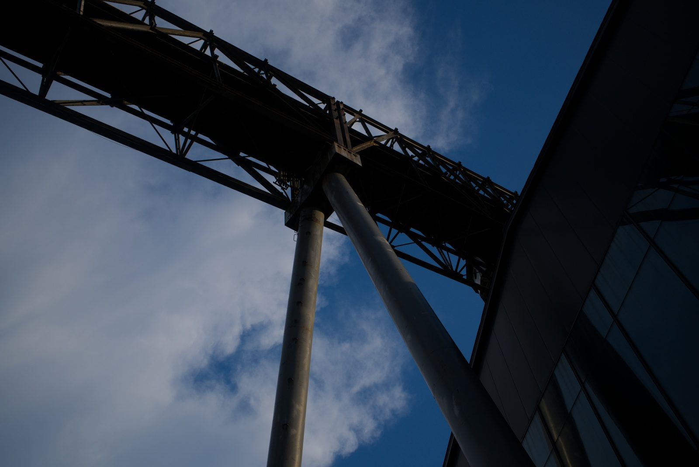 | 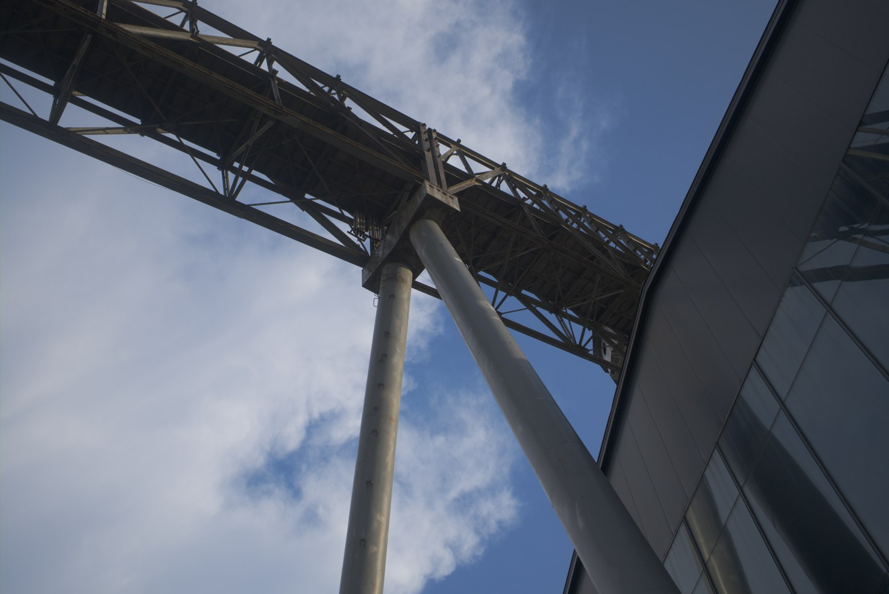 |

> Read more: [Editing tutorial (ZH)](docs/EDITING_TUTORIAL.zh-CN.md) · [Auto-exposure promotion record](docs/assets/delivery-quality/joint-exposure-promotion-20261012.json)

---

### 2. Shows what is actually in the RAW

Open a RAW and AgXRAW reports what the sensor recorded: clipped pixel ratios per channel, the brightest genuinely measured highlight (`p99.99`), and how many stops an HDR export can add. Toggle the **RAW clipping overlay** on the preview to see where the sensor hit its ceiling — it reflects capture facts and never shifts when you drag sliders, cleanly separating "no data left in the RAW" from "simply rendered too bright."

> Read more: [User guide · Detected parameters & clipping overlay](docs/USER_GUIDE.md)

---

### 3. Real HDR photo export

The three images below are **real HDR files** exported by AgXRAW, not illustrations. On an HDR display with a supporting browser (Safari or Chrome on Mac / iPhone, Chrome on Android 15+), lamps and highlights shine visibly brighter than the page background. On non-HDR displays, browsers seamlessly show the embedded SDR rendition.

| Figure and lamp · +2.35 stops above white | Stage lights · +1.35 stops |
| --- | --- |
| 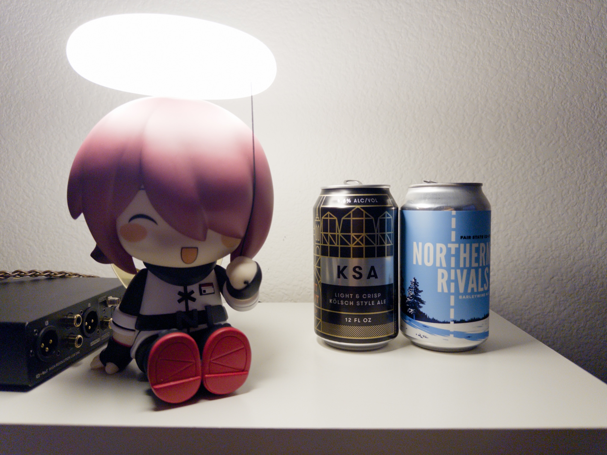 | 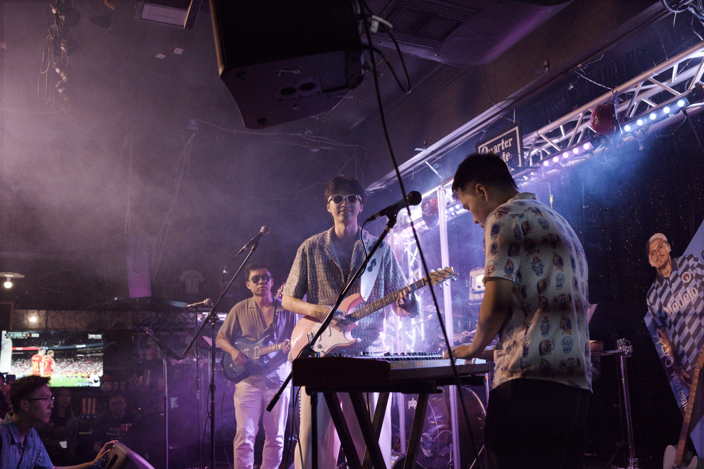 |

| Restaurant light tubes · +1.45 stops |
| --- |
| 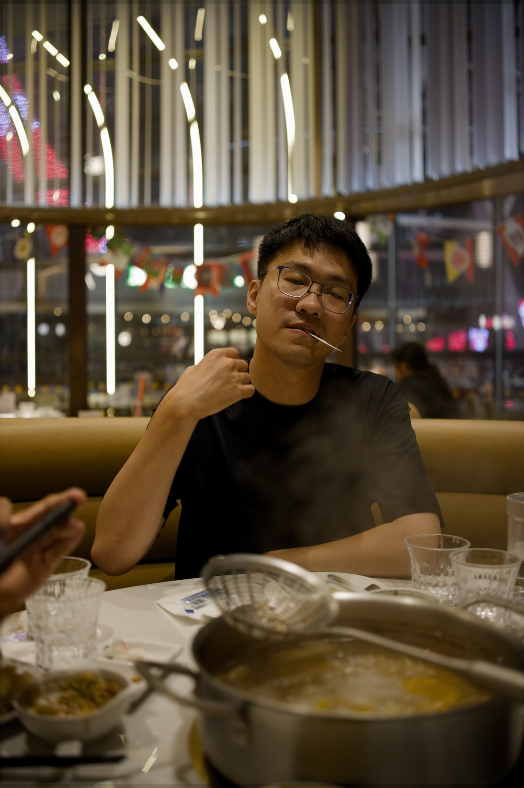 |

The HDR rendition is never a stretched SDR image — it is rendered **independently** from the same linear scene data. Available headroom is bounded strictly by measured, non-clipped highlights; if none exist, export fails explicitly instead of fabricating headroom. Every written file is reopened and verified.

> Read more: [HDR tutorial (ZH)](docs/HDR_TUTORIAL.zh-CN.md) · [HDR delivery validation (ZH)](docs/HDR_DELIVERY_VALIDATION.zh-CN.md)

---

### 4. Twenty data-driven film stocks

Includes 20 stocks across colour negative, cinema negative, and slide film (Kodak Portra, Ektar, Gold, UltraMax, VISION3, Verita, Ektachrome, Kodachrome; Fujifilm Velvia, Provia, Superia, Pro 400H, C200). Each stock is a **fixed, data-driven AgX rendering**: black-point-compensated print/slide tone curve, per-hue colour rendition and grey-scale crossover from spectral film simulations, ISO 2240 metered mid-grey for reversal stocks, and continuous negative-density grain matched to datasheet granularity.

Select a stock from the **Film** card in the GUI or pass `--film portra400` on the CLI (currently SDR-only).

| AgX (no film) | Kodak Portra 400 |
| --- | --- |
| 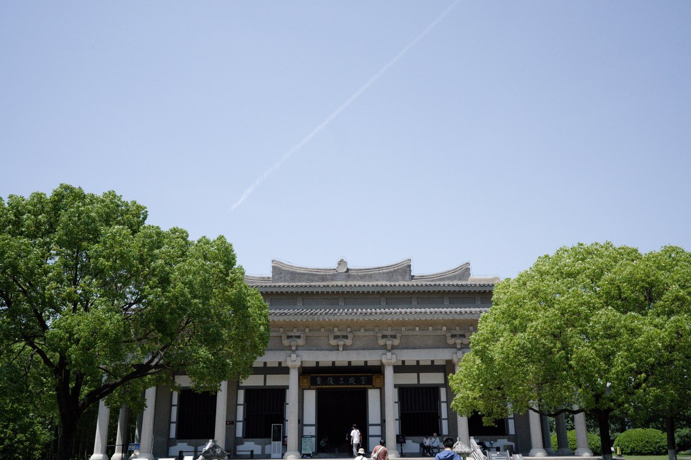 | 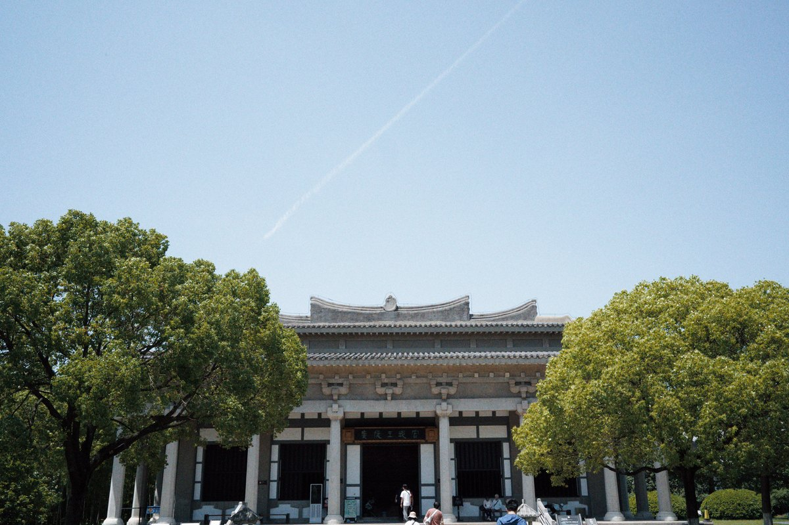 |
| **Fujifilm Velvia 100** | **Kodak Vision3 250D** |
| 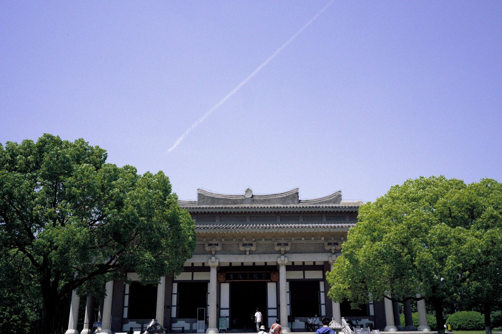 | 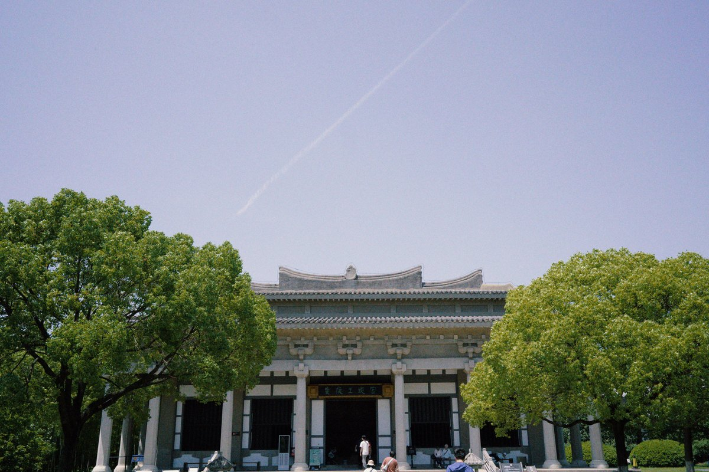 |

> Read more: [Film tutorial (ZH)](docs/FILM_TUTORIAL.zh-CN.md) · [Film model & data (ZH)](docs/FILM.zh-CN.md) (film profiles derive from [spektrafilm](https://github.com/andreavolpato/spektrafilm) by Andrea Volpato, CC BY-SA 4.0; see [NOTICE.md](NOTICE.md))

---

### 5. Dual RAW decoders & readback-verified delivery

- **Two decoders, one pipeline**: **LibRaw** covers nearly every camera by default; on macOS you can switch to **Apple RAW** (Core Image, including RAW 9). Both deliver linear wide-gamut pixels into the exact same analysis and rendering stages.
- **Verified encoding profiles**: Default `auto` mode searches JPEG `q95–q99` via actual readback checks (preferring `4:2:2`, stepping to `4:2:0` when colour error stays bounded); `share-hq` fixes `q97 / 4:2:0` at full resolution; `archive` locks `q100 / 4:4:4`; HEIF supports `libheif/x265` 10-bit floating masters with float readback verification.

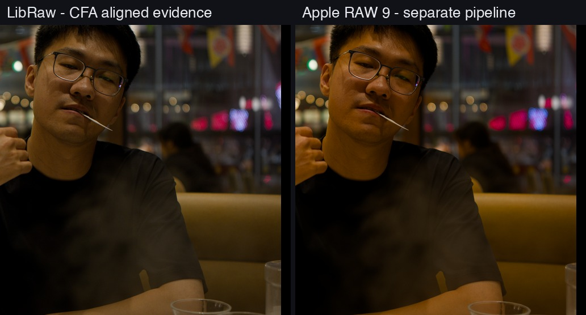

> Read more: [Sensor support (ZH)](docs/SENSOR_SUPPORT.zh-CN.md) · [Delivery quality & size study (ZH)](docs/DELIVERY_QUALITY_STUDY.zh-CN.md)

---

### 6. Shared parameters across GUI and CLI

The local web workbench and the CLI share the same rendering and delivery parameters — anything dialed in the browser reproduces as a single CLI command. Add `--report` for a full text analysis report, or `--scan` / `--csv` for a six-panel diagnostic dashboard and metrics table.

---

## Quick start

### Requirements

- **Platform**: **Apple Silicon Mac** (macOS) with Python 3.11+ (Apple RAW decoding and HDR gain-map export rely on macOS frameworks; Intel Macs and older OSes are untested).
- **Build tools**: Git and Xcode Command Line Tools (the pinned `rawpy` / LibRaw revision compiles locally on first install).
- **Package name**: The Python package and CLI retain the engine's original name `dngscan`.

### Install & launch the local web GUI

```bash
git clone https://github.com/Gen-416/AgXRAW.git
cd AgXRAW
python3 -m venv .venv
source .venv/bin/activate
pip install -r requirements.txt
python -m dngscan.gui
```

Open the `http://127.0.0.1:...` URL printed in your terminal. Selected RAWs stay strictly on localhost in a temporary directory that is cleaned up on exit.

### Common CLI commands

```bash
# Default AgX render (auto exposure + auto JPEG quality)
python -m dngscan photo.dng --jpeg photo.jpg

# High-quality sharing (fixed JPEG q97 / 4:2:0, full resolution; warns above 20 MB)
python -m dngscan photo.dng --jpeg photo_share.jpg --delivery-profile share-hq

# Film simulation (list all 20 stocks: --film list)
python -m dngscan photo.dng --film portra400 --jpeg photo_portra.jpg

# Apple RAW 9 decoder (macOS)
python -m dngscan photo.dng --decoder coreimage --coreimage-version 9 --jpeg photo_raw9.jpg

# Highlight reconstruction + Display P3 + full analysis report
python -m dngscan photo.dng --jpeg photo_p3.jpg \
  --highlight-mode reconstruct --output-gamut p3 --report

# True HDR JPEG (macOS)
python -m dngscan photo.dng --jpeg photo_hdr.jpg \
  --output-format ultrahdr --hdr-headroom 3

# Diagnostic dashboard and CSV metrics
python -m dngscan photo.dng --jpeg photo.jpg --scan --csv photo.csv
```

Run `python -m dngscan --help` to see every option.

### Optional: build native Rust acceleration

Everything runs in pure Python/NumPy out of the box. Building the optional Rust kernels (`rust/`) accelerates rendering, HDR formation, and readback checks while remaining verified against the NumPy reference under declared exactness or tolerance contracts (historically ~7 s for 24 MP SDR JPEG and ~10 s for HDR; actual time varies by decoder, encoder profile, and hardware):

```bash
# Install Rust toolchain first: https://rustup.rs
pip install setuptools-rust
tools/build_native.sh
```

`pip install .` builds the kernels automatically when Cargo is available; pass `DNGSCAN_BUILD_NATIVE=OFF` for a pure-Python install.

---

## How it works

AgXRAW separates **"what the sensor measured"** from **"what picture you want"**, joining them only when compiling an immutable render plan:

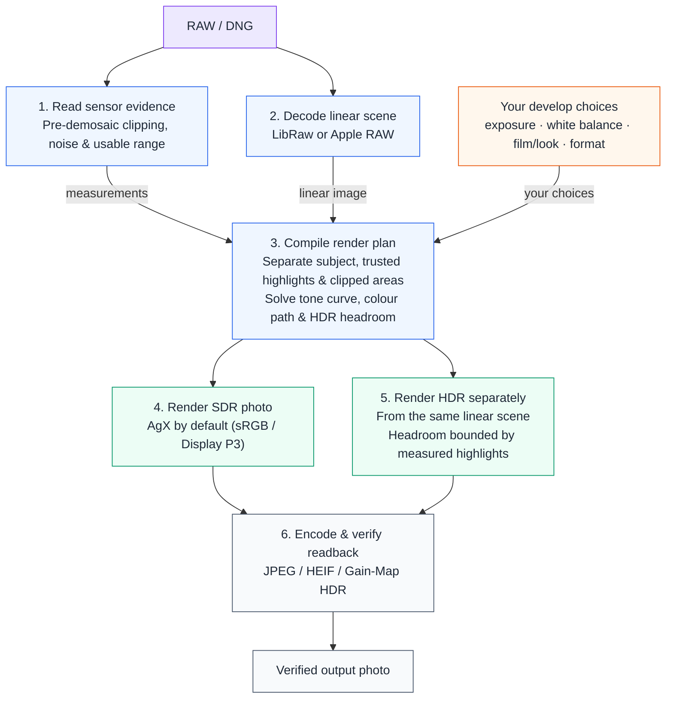

### Four ways AgXRAW differs from typical RAW editors

1. **Sensor evidence stays in the loop to the end**: Most editors discard raw CFA state after demosaicing. AgXRAW keeps pre-demosaic clipping and noise records so tone curves know which highlights are real and colour paths stay conservative where data was clipped or reconstructed.
2. **Analysis builds an editable starting point — not hidden taste**: Black/white levels, clipping, noise, and scene distribution drive bounded joint exposure and tone planning (no unsolicited look boost, camera white balance by default, shared plan between preview and export), while manual controls always take precedence.
3. **HDR is formed independently and verified on readback**: SDR and HDR start from the same linear data, render separately, and written files are reopened to validate headroom, colour profile, and reconstruction error.
4. **Every stage is modular and replaceable**: Swapping decoders does not rewrite analysis or tone mapping; switching tone cores reuses the same analysis; encoders only consume finished renditions — making apples-to-apples comparisons straightforward.

> AgXRAW intentionally skips library management and local masks. It serves both as a focused tool for making pictures and as an open imaging workbench where every step explains itself.

---

## Documentation & repository map

### Where to start

- **Using AgXRAW**: [User Guide](docs/USER_GUIDE.md) · [Editing Tutorial (ZH)](docs/EDITING_TUTORIAL.zh-CN.md) · [Film Tutorial (ZH)](docs/FILM_TUTORIAL.zh-CN.md) · [HDR Tutorial (ZH)](docs/HDR_TUTORIAL.zh-CN.md) · [Sensor Support (ZH)](docs/SENSOR_SUPPORT.zh-CN.md)
- **Architecture & development**: [Developer Guide (ZH)](docs/DEVELOPMENT.zh-CN.md) · [Product Architecture](docs/PRODUCT_ARCHITECTURE.md) · [Pipeline Architecture](docs/ARCHITECTURE.md) · [Film Model (ZH)](docs/FILM.zh-CN.md) · [Reports & Baselines](docs/reports/README.md)

### Repository layout

| Path | Purpose |
| --- | --- |
| [dngscan/](dngscan) | Python imaging pipeline, film engine, CLI, and local web GUI |
| [rust/](rust) | Optional native Rust computation kernels |
| [dngscan/data/](dngscan/data) · [dngscan_assets/](dngscan_assets) | Bundled calibration & film assets / raw references & provenance |
| [tests/](tests) · [tools/](tools/README.md) | Regression test suite / calibration, showcase, and benchmark scripts |
| [docs/](docs/README.md) · [docs/reports/](docs/reports/README.md) | Guides, tutorials, architecture contracts, and historical baselines |

---

## License

AgXRAW is free and open-source software released under [GPL-3.0-or-later](LICENSE). Bundled third-party data retains its original terms — notably film simulation profiles derived from spektrafilm (CC BY-SA 4.0) — as detailed in [NOTICE.md](NOTICE.md).
