# AgXRAW

把 RAW 照片显影成忠实的 JPEG、HEIF 和真 HDR 照片，并让每一步都有实测依据。开源、本地运行，RAW 文件不会上传。

[English](README.md) · [使用说明](docs/USER_GUIDE.zh-CN.md) · [修图教程](docs/EDITING_TUTORIAL.zh-CN.md) · [胶片教程](docs/FILM_TUTORIAL.zh-CN.md) · [HDR 教程](docs/HDR_TUTORIAL.zh-CN.md) · [机型支持](docs/SENSOR_SUPPORT.zh-CN.md) · [完整文档索引](docs/README.md)

---

AgXRAW 最初只想解决一个具体问题：不用打开一整套修图软件，也能用 AgX 把一张 RAW 显影好。往深处做时，更核心的问题浮现出来——传感器到底保留了多少高光？算法补出来的高光还能信多少？同一份 RAW 数据怎样分别做成普通照片和真 HDR 照片？AgXRAW 把这些问题收进了一套**可测量、可复现**的本地流程里。

项目面向多品牌相机的 RAW（含 Bayer、X-Trans 与解码器支持的线性 DNG），**不需要提前做个人标定就能直接使用**：缺少适用噪声模型时，仍按图像统计完成自动曝光、AgX 成像与导出，并在界面和报告中明确标出「通用成像（噪声未标定）」。

---

## 核心能力

### 1. 默认即可出片的 AgX 显影

AgX 是默认成像方式：高光自然过渡到白，亮部颜色不会又艳又假。打开照片后，AgXRAW 会先分析主体亮度、动态范围与过曝区域，通过受约束的自动曝光与自适应影调定好起点，通常直接导出就能得到可用成片。

需要微调时，按 **范围 → 亮度 → 色彩补偿** 的顺序操作，每个滑条只管一件事；手动调整曝光会切换为固定端点模式，`--ev 0` 可保留拍摄曝光锚点。

| 默认渲染（未作调整） | 放出更深暗部，再整体提亮 1 档 |
| --- | --- |
| 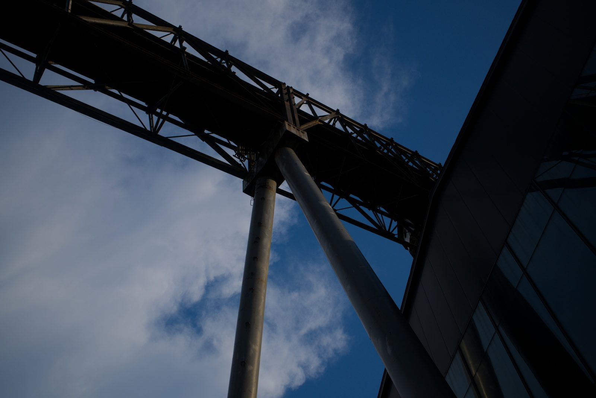 | 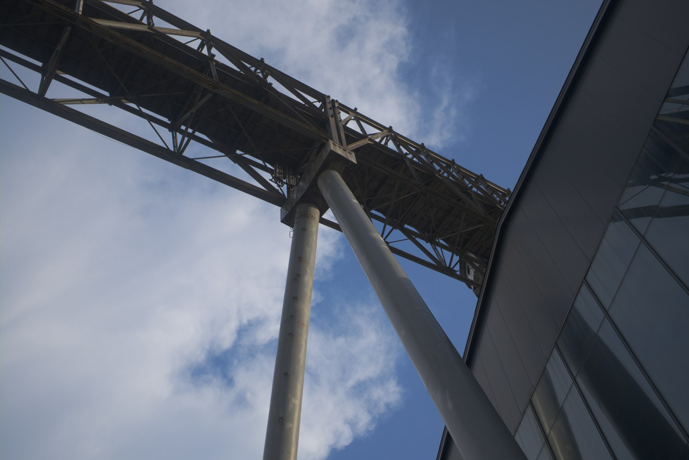 |

> 深入阅读：[修图教程](docs/EDITING_TUTORIAL.zh-CN.md)（每个滑条的作用与实拍对照） · [自动曝光规划验收记录](docs/assets/delivery-quality/joint-exposure-promotion-20261012.json)

---

### 2. 看清 RAW 里的真实信息

打开一张 RAW，AgXRAW 会先给出传感器测量结果：过曝占比与通道分布、确实测到的最亮高光（p99.99）、以及做成 HDR 最多能多亮几档。预览上可随时叠加 **RAW 过曝标记**——它记录的是拍摄时的传感器事实，不随曝光或曲线移动，能帮你分清“RAW 里已经没有信息了”还是“只是当前渲染得太亮”。

> 深入阅读：[使用说明 · 检测参数与过曝标记](docs/USER_GUIDE.zh-CN.md)

---

### 3. 导出真正的 HDR 照片

下面三张是 AgXRAW 导出的**真 HDR 文件**（非示意图）。在支持 HDR 的屏幕与浏览器上（Mac / iPhone 的 Safari 或 Chrome、Android 15+ 的 Chrome），灯光和高光会明显亮于页面白色背景；在不支持的设备上则自动显示内嵌的普通版，不会发灰或出错。

| 手办与灯 · 比参考白亮 2.35 档 | 舞台灯 · 亮 1.35 档 |
| --- | --- |
| 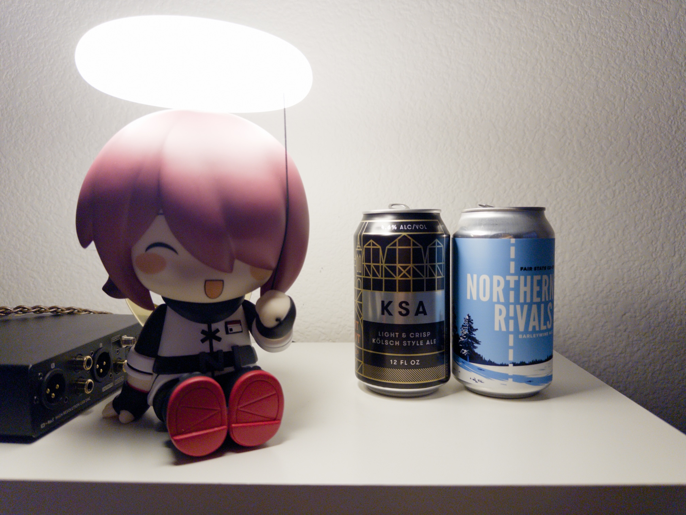 | 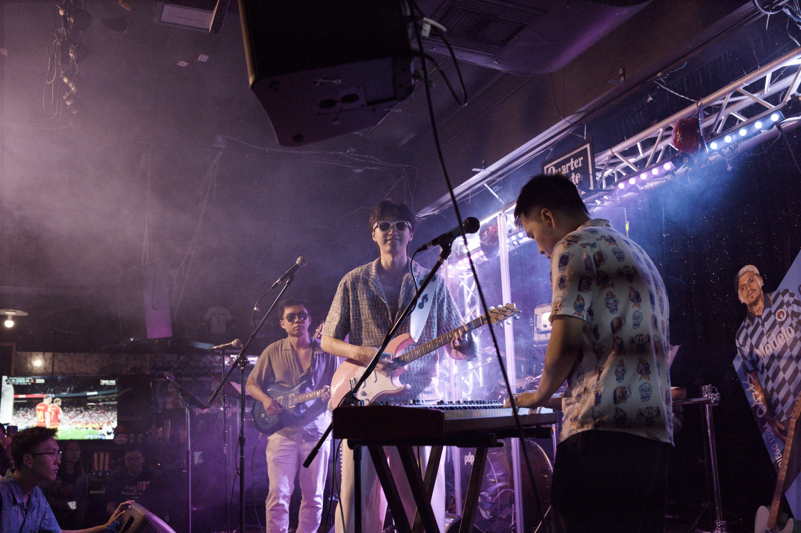 |

| 餐厅灯管 · 亮 1.45 档 |
| --- |
| 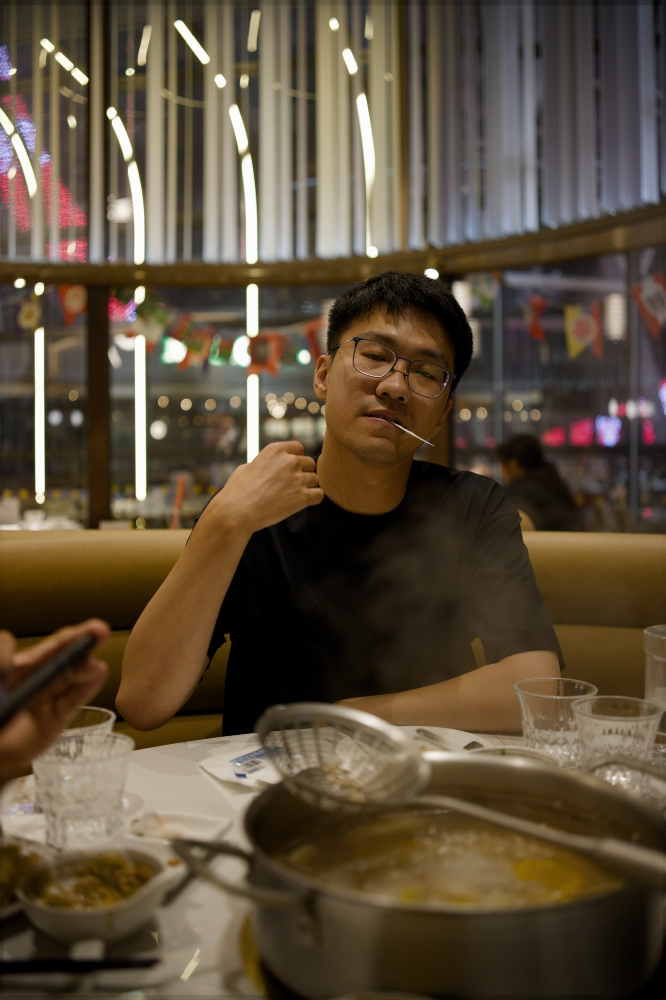 |

HDR 版并非把普通照片拉亮，而是从同一份线性数据**独立成像**；能亮多少只取决于传感器确实测到的高光，测不到就明确报错，绝不硬造余量。每个文件写出后都会重新读回核对。

> 深入阅读：[HDR 教程](docs/HDR_TUTORIAL.zh-CN.md) · [HDR 编码回读验证](docs/HDR_DELIVERY_VALIDATION.zh-CN.md)

---

### 4. 内置 20 卷数据驱动的胶片模拟

内置 20 种经典胶片（Kodak Portra、Ektar、Gold、UltraMax、VISION3、Verita、Ektachrome、Kodachrome；Fujifilm Velvia、Provia、Superia、Pro 400H、C200），涵盖彩色负片、电影负片与反转片。每卷胶片是一套**固定规则的 AgX 渲染**：包含黑点适应后的相纸/幻灯片曲线、来自光谱模拟的按色相颜色还原与灰阶层间漂移、反转片的 ISO 2240 测光中灰，以及按数据手册颗粒度施加在负片密度上的连续颗粒。

在网页界面的「胶片」卡片中选择，或通过命令行 `--film portra400` 启用（目前仅支持 SDR）。

| AgX（不选胶片） | Kodak Portra 400 |
| --- | --- |
| 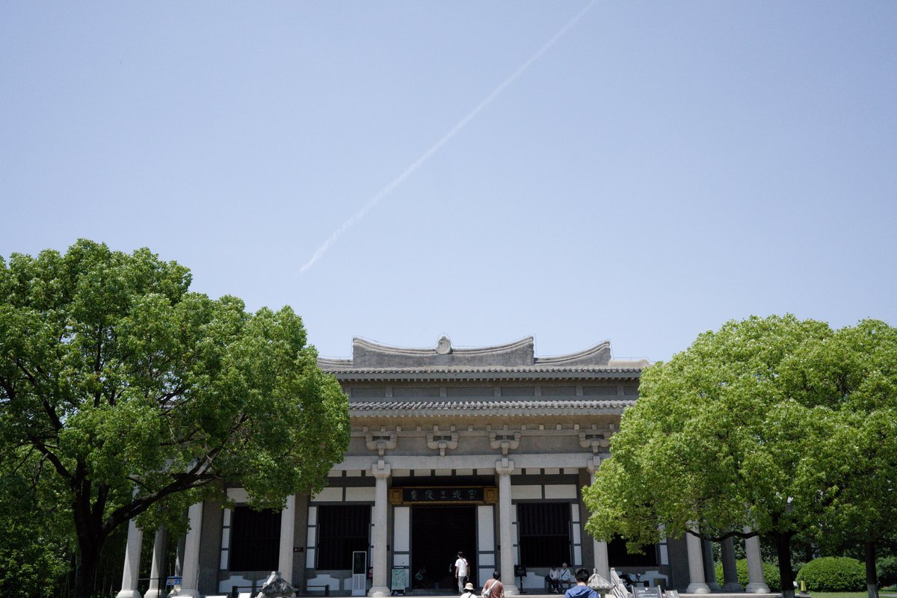 | 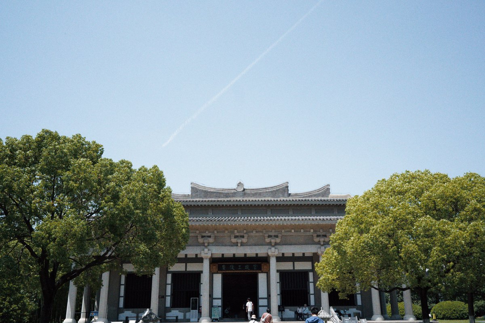 |
| **Fujifilm Velvia 100** | **Kodak Vision3 250D** |
| 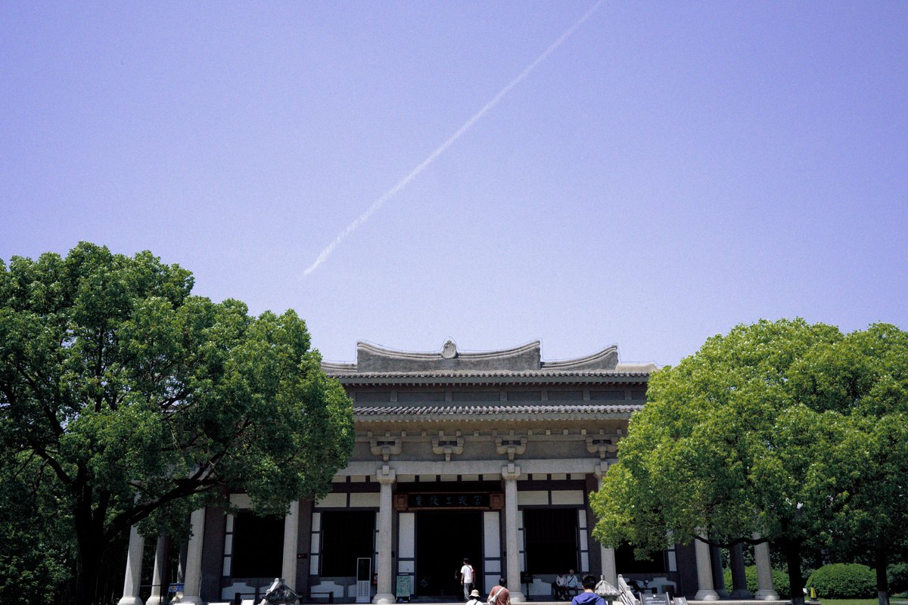 | 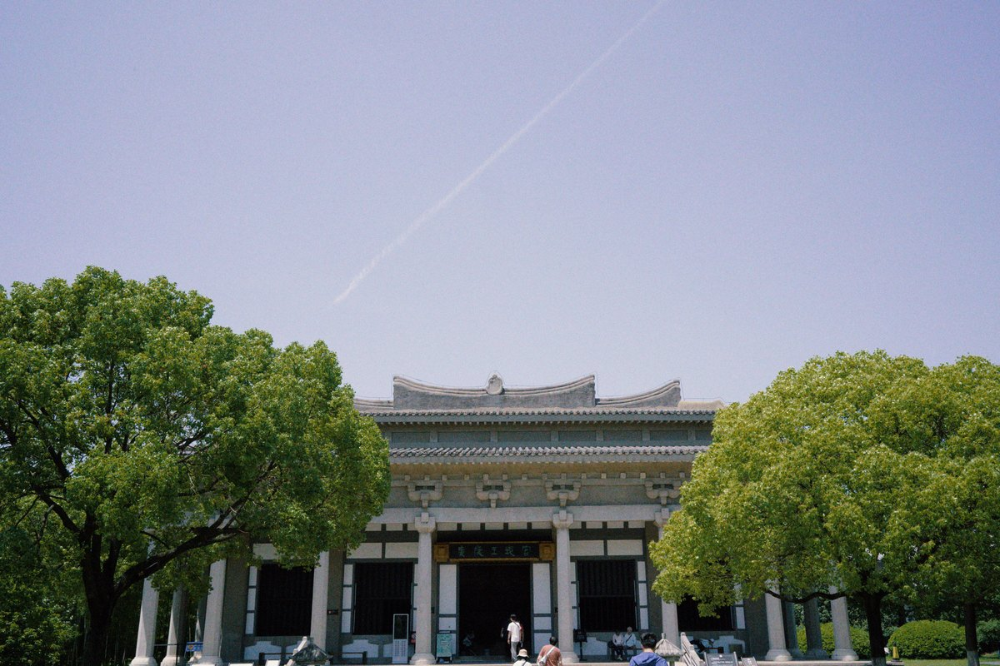 |

> 深入阅读：[胶片教程](docs/FILM_TUTORIAL.zh-CN.md) · [胶片模型与数据说明](docs/FILM.zh-CN.md)（数据派生自 Andrea Volpato 的 [spektrafilm](https://github.com/andreavolpato/spektrafilm)，CC BY-SA 4.0，详见 [NOTICE.md](NOTICE.md)）

---

### 5. 双 RAW 解码器与可验证交付

- **双解码器同管线对比**：默认使用 **LibRaw** 覆盖主流相机；在 macOS 上可切换为系统自带的 **Apple RAW**（含最新 RAW 9）。两者输出统一的线性广色域数据，接入同一套分析与成像流程。
- **质量可控、写后必检的导出**：默认自动编码在 JPEG `q95–99` 间按回读误差择优（优先 `4:2:2`，误差受限时启用更小的 `4:2:0`）；提供 `share-hq`（固定 `q97 / 4:2:0` 原尺寸高质量分享）与 `archive`（`q100 / 4:4:4`）；HEIF 支持 `libheif/x265` 的 10-bit 浮点母版编码与浮点回读验证。

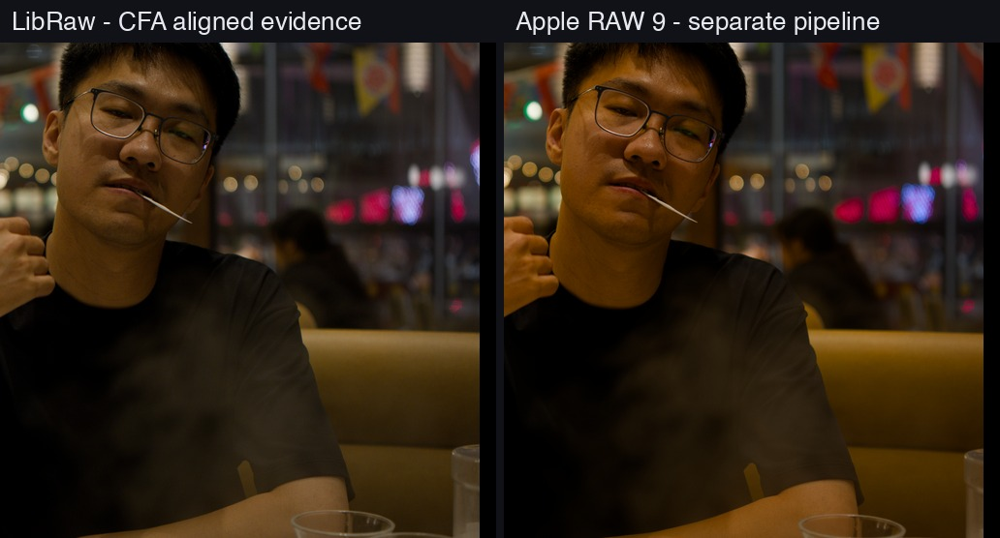

> 深入阅读：[机型支持](docs/SENSOR_SUPPORT.zh-CN.md) · [JPEG / HEIF 质量与体积实测](docs/DELIVERY_QUALITY_STUDY.zh-CN.md)

---

### 6. 网页界面与命令行共用同一套参数

本地网页界面和命令行共享同一套显影与编码逻辑：界面里调出的效果，都能用一行命令精确复现。命令行附带 `--report` 可打印完整分析报告，附带 `--scan` / `--csv` 可生成六格诊断图与数据表。

---

## 快速开始

### 运行环境

- **平台**：Apple Silicon Mac（macOS），Python 3.11 或更新版本（Apple RAW 与 HDR 导出依赖 macOS 系统框架，Intel Mac 及旧系统未测试）。
- **编译工具**：Git 与 Xcode Command Line Tools（首次安装会本地编译锁定版本的 `rawpy` / LibRaw）。
- **命名说明**：Python 包名与命令行入口沿用引擎原名 `dngscan`。

### 安装并启动网页界面

```bash
git clone https://github.com/Gen-416/AgXRAW.git
cd AgXRAW
python3 -m venv .venv
source .venv/bin/activate
pip install -r requirements.txt
python -m dngscan.gui
```

在浏览器中打开终端输出的 `http://127.0.0.1:...` 地址即可使用。选中的 RAW 仅传给本机服务，暂存于临时目录并在退出后自动清理，不会发往任何外部服务器。

### 常用命令行示例

```bash
# 默认 AgX 出片（自动曝光 + 自动编码质量）
python -m dngscan photo.dng --jpeg photo.jpg

# 高质量分享档（固定 JPEG 97 / 4:2:0，保留原尺寸；超 20 MB 仅提示）
python -m dngscan photo.dng --jpeg photo_share.jpg --delivery-profile share-hq

# 启用胶片模拟（查看全部 20 卷：--film list）
python -m dngscan photo.dng --film portra400 --jpeg photo_portra.jpg

# 切换 Apple RAW 9 解码器
python -m dngscan photo.dng --decoder coreimage --coreimage-version 9 --jpeg photo_raw9.jpg

# 高光重建 + Display P3 广色域 + 打印分析报告
python -m dngscan photo.dng --jpeg photo_p3.jpg \
  --highlight-mode reconstruct --output-gamut p3 --report

# 导出真 HDR JPEG（需要 macOS）
python -m dngscan photo.dng --jpeg photo_hdr.jpg \
  --output-format ultrahdr --hdr-headroom 3

# 生成六格诊断图与数据表
python -m dngscan photo.dng --jpeg photo.jpg --scan --csv photo.csv
```

查看全部选项：`python -m dngscan --help`。

### 可选：编译 Rust 原生加速核

不编译原生扩展也可正常使用（纯 NumPy 实现为基准）。编译 [rust/](rust) 目录下的原生计算核后，可显著加速成像、HDR 与回读校验（每个核均按声明的精确度或容差合同与 NumPy 基准对照验证；在 24 MP 历史基准下，普通 JPEG 约 7 秒、HDR 约 10 秒，实际耗时取决于解码器、编码设置与硬件）：

```bash
# 需先安装 Rust 工具链：https://rustup.rs
pip install setuptools-rust
tools/build_native.sh
```

`pip install .` 也会自动尝试编译；无 Rust 工具链或设置 `DNGSCAN_BUILD_NATIVE=OFF` 时自动退回纯 Python 安装。

---

## 工作原理

AgXRAW 把 **“传感器测到了什么”** 和 **“你想要什么样的照片”** 分开处理，只在成像阶段汇总编译为只读渲染计划：

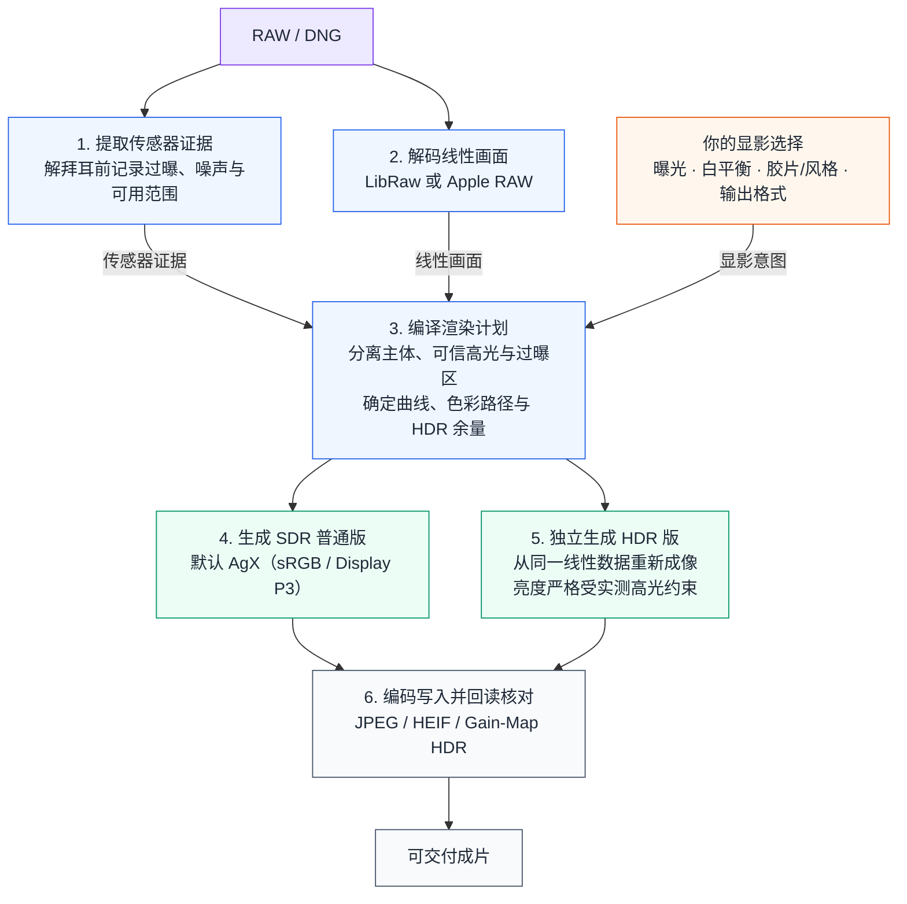

### 与常见 RAW 软件的四个区别

1. **传感器证据贯穿到底**：多数软件在解拜耳后就丢弃了原始传感器状态；AgXRAW 始终保留解码前的过曝与噪声证据，让曲线知道哪些高光可信，色彩处理也会对过曝和重建区域保持克制。
2. **自动给出可编辑起点，而非替你做审美决定**：黑白电平、过曝、噪声与场景分布决定默认的受约束自动曝光与影调曲线（默认不额外提亮，白平衡尊重相机记录，预览与导出共用同一计划），手动调整随时可覆盖建议。
3. **HDR 从源数据独立成像并回读验收**：不是把普通版拉亮，而是各自从线性场景出发，写出后重新打开核对余量、色域与像素误差。
4. **各环节解耦可替换**：更换解码器无需重写分析或成像；切换影调核心复用同一份分析；输出编码只接收已完成成片，便于在同一张照片上做公平对照。

> AgXRAW 定位清晰：不做图库管理，也不做局部蒙版精修。它既能直接用于日常出片，也是一座每一步都说得清依据的开源成像实验台。

---

## 文档导航与仓库结构

### 按角色阅读

- **日常使用与出片**：[使用说明](docs/USER_GUIDE.zh-CN.md) · [修图教程](docs/EDITING_TUTORIAL.zh-CN.md) · [胶片教程](docs/FILM_TUTORIAL.zh-CN.md) · [HDR 教程](docs/HDR_TUTORIAL.zh-CN.md) · [机型支持](docs/SENSOR_SUPPORT.zh-CN.md)
- **架构理解与开发**：[开发指南与仓库地图](docs/DEVELOPMENT.zh-CN.md) · [产品架构与领域模型](docs/PRODUCT_ARCHITECTURE.zh-CN.md) · [成像管线与技术细节](docs/ARCHITECTURE.zh-CN.md) · [胶片模型说明](docs/FILM.zh-CN.md) · [测量与历史报告](docs/reports/README.md)

### 仓库目录

| 路径 | 职责 |
| --- | --- |
| [dngscan/](dngscan) | Python 成像管线、胶片引擎、CLI 与本地网页 GUI |
| [rust/](rust) | 可选 Rust 原生计算核 |
| [dngscan/data/](dngscan/data) · [dngscan_assets/](dngscan_assets) | 随包标定与胶片资产 / 原始参考数据与出处 |
| [tests/](tests) · [tools/](tools/README.md) | 回归测试 / 显式标定、样张生成与性能测量工具 |
| [docs/](docs/README.md) · [docs/reports/](docs/reports/README.md) | 教程、使用说明、架构合同与历史测量基线 |

---

## 许可证

AgXRAW 以 [GPL-3.0-or-later](LICENSE) 开源发布。随附第三方数据保留各自条款——其中胶片模拟数据派生自 spektrafilm（CC BY-SA 4.0）——完整清单见 [NOTICE.md](NOTICE.md)。
