# 修图教程：每个滑条做什么

[返回首页](../README.zh-CN.md) · **修图教程** · [胶片教程](FILM_TUTORIAL.zh-CN.md) · [HDR 教程](HDR_TUTORIAL.zh-CN.md) · [使用说明](USER_GUIDE.zh-CN.md) · [技术架构](ARCHITECTURE.zh-CN.md)

> **版本提示**：当前版本默认开启分析驱动的自动曝光。本文既有对比图保留了录制时的显式 EV 设置；如需复现零曝光对照，请取消勾选「自动曝光」或在命令行加上 `--ev 0`。

这份教程只回答一个问题：**每个滑条到底改了画面的哪一部分？** 至于“这张照片该不该这么调”，交给你的眼睛判断。文中所有对比图都由 AgXRAW 按所列参数实拍渲染（非示意图），每一条结论旁都附有实测依据。

## 一句话记住修图顺序

> **范围 → 亮度 → 色彩补偿**
>
> 1. **定范围**：决定多暗、多亮的内容要显示出来（黑白点依据、暗部收黑、高光收白）；
> 2. **定亮度**：决定画面放多亮（曝光 EV、中间调亮度）；
> 3. **补色彩**：补回中间调提亮带来的饱和度损失（色彩浓度）。

按这个顺序推进，通常不需要反复回头。下文用三张样张逐一演示，同时也收录了两个**“滑条拉动却毫无变化”**的反例——知道什么时候用不上，和知道怎么用同样重要。

| 样张 | 相机 | 演示重点 |
| --- | --- | --- |
| 一 · 大逆光钢桥 | 富士 X100VI，ISO 250 | 范围（黑白点与暗部）、EV 与中间调的分工、色彩浓度补偿；**高光收白在这张上调不动** |
| 二 · 航机厨房 | iPhone 16 Pro，ISO 200 | 什么都不用调的对照；顶灯板演示三种高光模式；**色彩浓度在这张上自动值为 0** |
| 三 · 手办与灯 | iPhone 16 Pro，ISO 200 | 灯不动、手办提亮的组合用法；真实过曝场景下的高光收白；RAW 过曝标记与 HDR 余量读法 |

---

## 第零步 · 先判断需不需要调

先看一张不需要动任何滑条的照片：航机厨房，人工光，正常曝光。

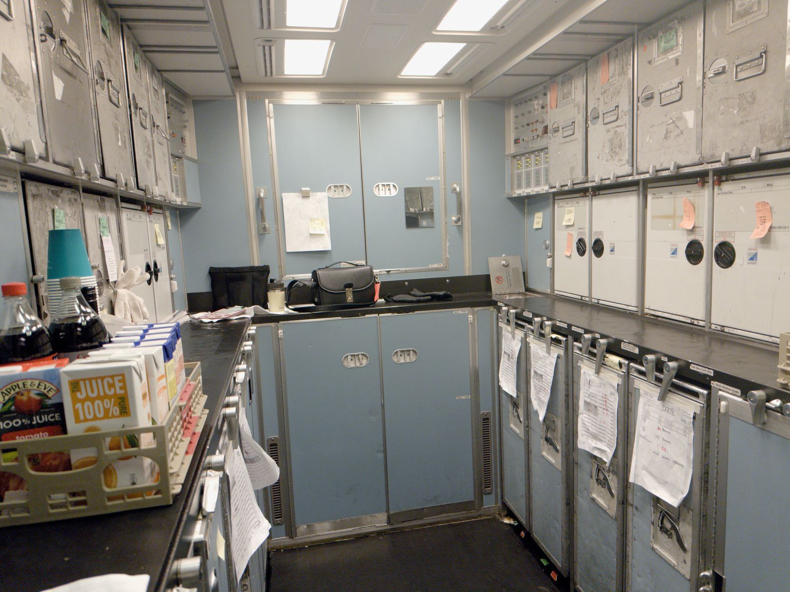

判断依据在曝光卡的**场景 EV 直方图**：这一帧从最暗到最亮的可信内容几乎全部落在黑白点之间——亮部完全装下，暗部只有 `0.4%` 落在黑点外。

**只要画面的可信亮度已经被黑白点完整装下，默认渲染往往就是成品。** 后面的每一步调整，本质上都是在直方图与曲线端点错开时，由你主动改写默认决定。

---

## 第一步 · 定范围：显示多少明暗信息？

看样张一（逆光钢桥）。默认渲染把黑点放在 `−6.9 EV`，把大片桥底钢架压成了剪影。这并非出错——在天空占主导的逆光画面里，默认自适应策略会优先保护中间调反差。如果你想要回桥底细节，就从「范围」开始。

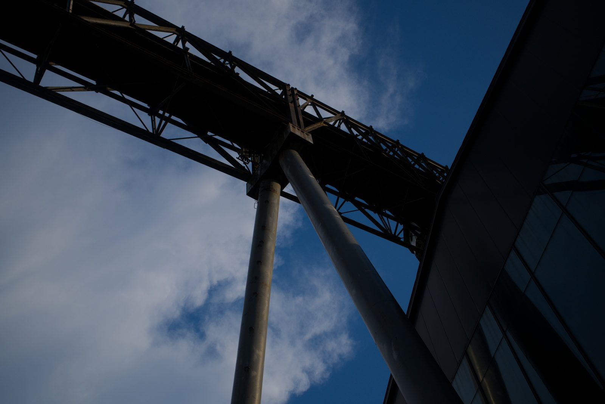

### 30 秒看懂明暗曲线

明暗卡上的所有控件都在调同一条曲线，它回答：**“现场这么亮的东西，在屏幕上该显示多亮？”**

下图是样张一实际生效的曲线（横轴为现场亮度，单位为档，`0` 为中灰，左暗右亮；纵轴为屏幕亮度，`0` 纯黑、`100` 纯白）：

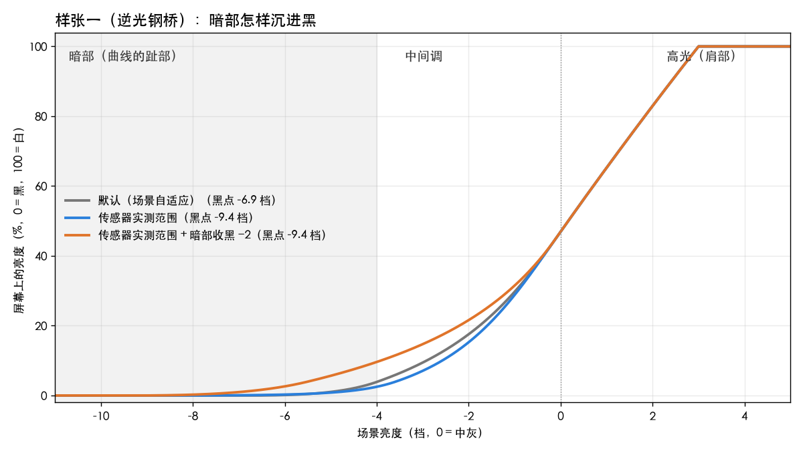

读曲线只需记住三件事：

- **中间一段近似直线**：现场每亮 1 档，屏幕按固定幅度变亮；斜率即中间调反差。
- **两头向黑白弯曲**：暗部贴近纯黑、高光贴近纯白（胶片术语称趾部和肩部，下文直称**暗部**与**高光**）。弯得缓，层次更柔；弯得急，过渡更硬。
- **贴底是黑点，贴顶是白点**：比黑点更暗的全成纯黑，比白点更亮的全成纯白。

因此「定范围」只有两类动作：**挪动黑白点**（黑白点依据），以及**改变两头弯曲的缓急**（暗部收黑、高光收白）。

---

### 1. 黑白点依据：黑白点放在哪？

- **场景自适应（默认）**：按照片亮度分布自动安放黑白点。
- **证据约束**（界面选项「证据约束 · 模型读噪底/可靠 RAW 尾部」）：黑点参考噪声模型给出的实测读噪底，白点只认可靠 RAW 尾部（不含重建高光）；缺少可用证据时按项回退并注明。

在曲线图上，灰线（默认）黑点在 `−6.9 档`，切到蓝线（证据约束）后黑点下探至 `−9.4 档`，暗部多出约 `2.5 档` 容纳空间；两条线在 `0 档` 重合，所以整体亮度不会跳变。

> **为什么单切「证据约束」画面几乎没变？**
> 看 `−4 档` 位置：灰线屏幕亮度是 `3.9%`，蓝线反而只有 `2.5%`。黑点虽挪远了，但暗部弯曲依然很急，新放进来的阴影仍挤在接近纯黑的地方——需要配合下一个滑条把弯拉开。
>
> 另外，**「证据约束」不等于“范围一定更宽”**：高感光度或小底相机的噪声底可能比自适应黑点更高，切过去后暗部反而会收窄。

---

### 2. 暗部收黑：暗部弯得多缓？

- **向左拉**：暗部弯得更缓，深阴影抬高、更晚沉入纯黑。
- **向右拉**：暗部弯得更急，更早沉黑，阴影更紧、更干脆。
- **不变的部分**：黑点、白点与 `0 档` 以上的中间调/高光完全不动。

对照曲线图上的橙线（证据约束 + 暗部收黑 `−2`）：

| 现场亮度 | 默认（灰线） | 证据约束（蓝线） | 证据约束 + 暗部收黑 −2（橙线） |
| --- | --- | --- | --- |
| −2 档 | 17.6% | 15.3% | **21.6%** |
| −4 档 | 3.9% | 2.5% | **9.6%** |
| −6 档 | 0.1% | 0.3% | **2.6%** |

回到照片上对比桥底钢架：

| 默认 | 证据约束 + 暗部收黑 −2 |
| --- | --- |
| 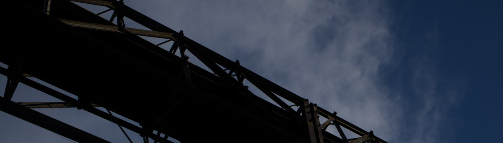 | 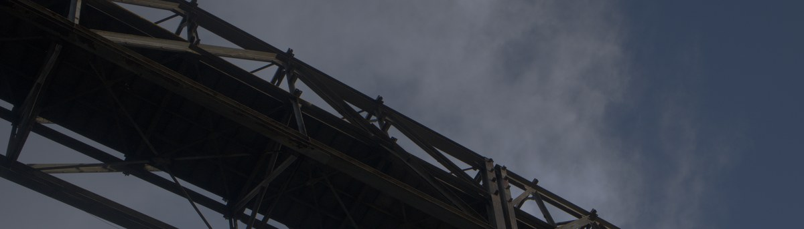 |

**看点**：腹杆、铆钉与锈迹从剪影中浮现，而天空亮度纹丝未动。

---

### 3. 高光收白：高光弯得多缓？

亮部同理：**向右拉**高光弯得更缓，亮部更晚顶白、层次更柔（代价是亮区略变暗）；**向左拉**更早变白，观感更硬、更通透。黑点、白点与中间调不动。

看样张三（手办与灯）的真实曲线——三条线白点都在 `+5.2 档`，仅弯曲形状不同：

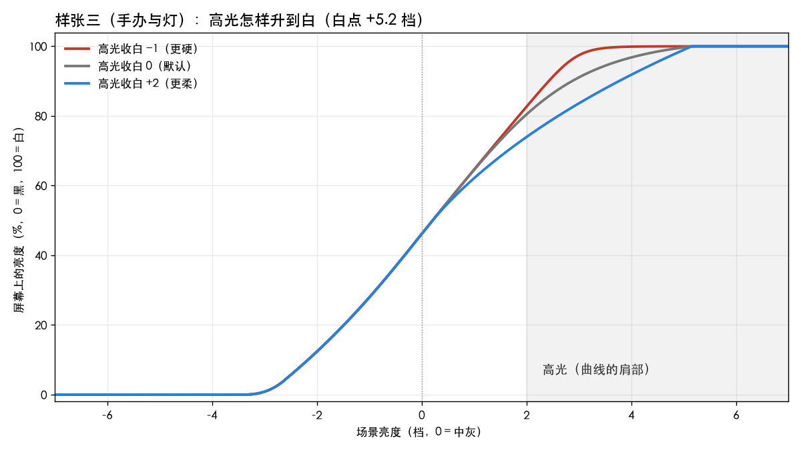

| 现场亮度 | 高光收白 −1（红线） | 高光收白 0（灰线） | 高光收白 +2（蓝线） |
| --- | --- | --- | --- |
| +2 档 | 82.7% | 80.4% | 74.0% |
| +3 档 | 97.4% | 91.1% | **83.6%** |
| +4 档 | 99.9% | 96.8% | **91.8%** |

红线在 `+3 档` 就已顶到 `97.4%`，`+3` 到 `+5 档` 全挤在最后 `3%` 里；蓝线在 `+3 档` 仅 `83.6%`，留出了 `16%` 的屏幕亮度给高光展开层次。

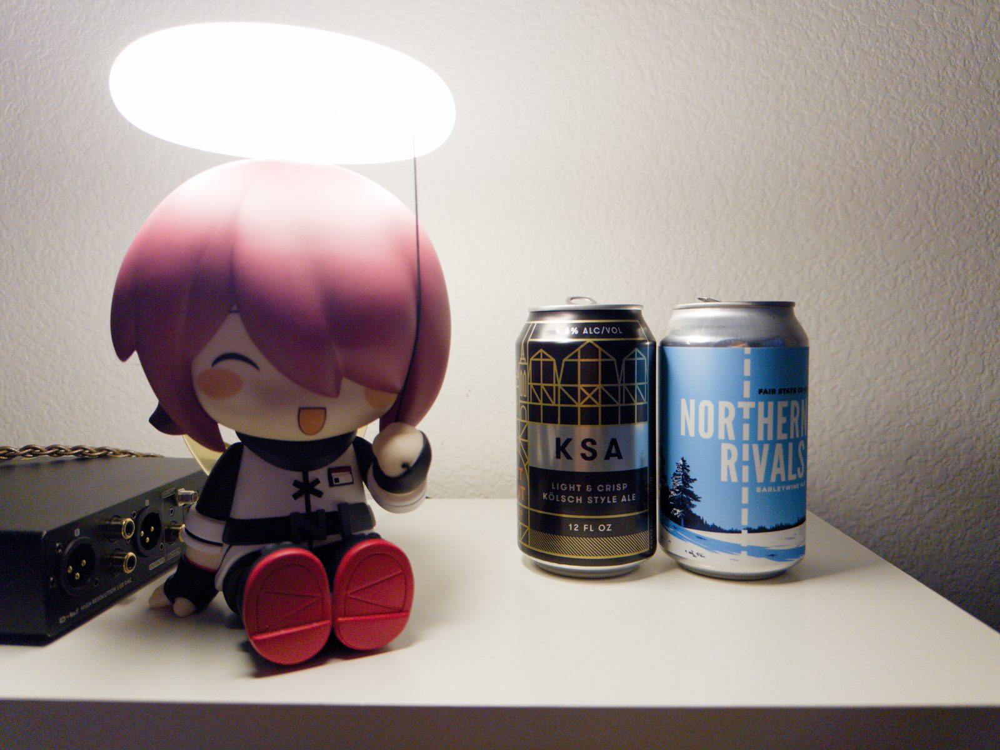

灯盘与白墙局部对比：

| 高光收白 −1（更硬） | 高光收白 0（默认） | 高光收白 +2（更柔） |
| --- | --- | --- |
| 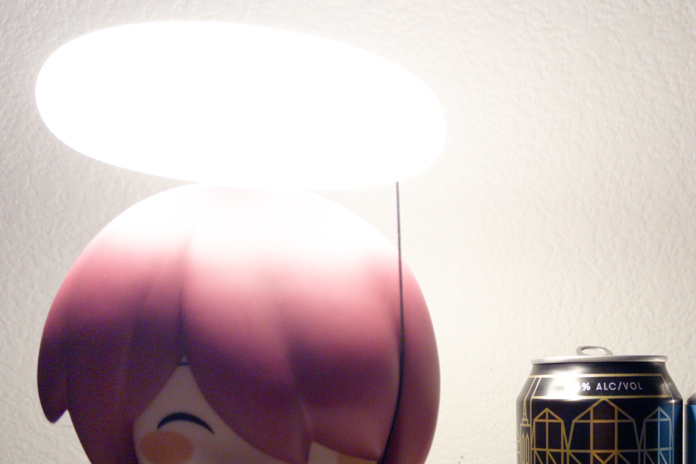 | 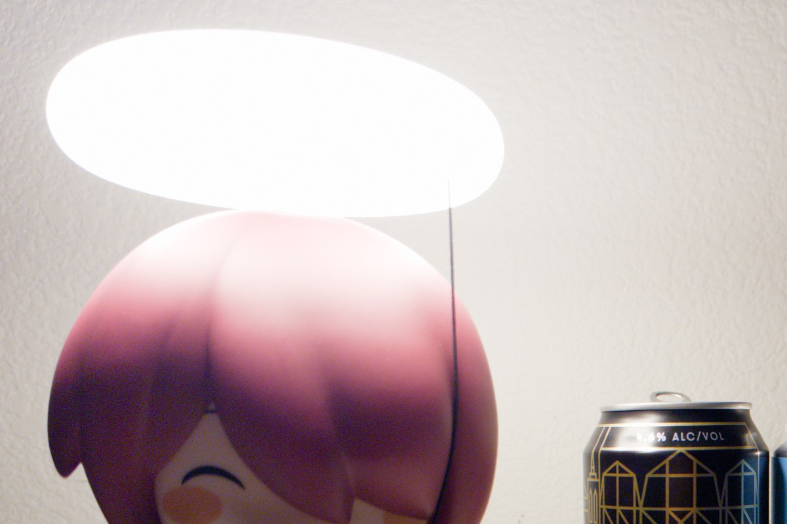 | 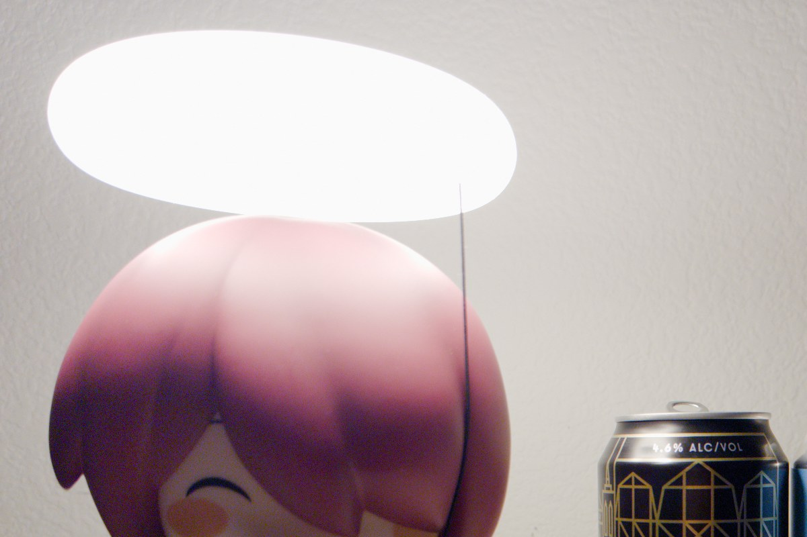 |

**实测变化**：从 `−1` 到 `+2`，纯白像素占比从 `18.8%` 经 `7.6%` 降至 `0%`；灯盘轮廓、光晕渐变与白墙肌理逐级分离。

> **先用「RAW 过曝标记」分清能不能救**
> 打开预览卡上的 **RAW 过曝标记**，传感器读数达到上限 `97%` 以上的像素会按通道标出（红/绿/蓝 = 单通道接近上限，白 = 三通道都接近上限）。旁边会显示全尺寸统计的 **完全过曝 R · G · B**（这才是真正丢信息的比例）与标记区占比；RAW 解码卡的「实测 RAW 过曝」口径相同。
> - **白色标记且完全过曝占比高**：拍摄时已无细节，任何滑条都救不回；
> - **标记区外围**：高光收白真正起作用的地方（如灯盘边缘光晕与白墙肌理）；
> - **标记不随滑条移动**：它记录拍摄事实，不是渲染亮度。

#### 为什么样张一的「高光收白」拉了没反应？

把「高光收白」放到样张一（钢桥）上，从 `−1` 拉到 `+2` 画面纹丝不动。原因在第一张曲线图右上角：**钢桥的曲线直线延伸到 `+3 档` 就直接撞到白点，根本没有弯曲段**。没有弯曲余地，自然谈不上调缓或调急；样张三能调动，是因为灯盘把白点推到了 `+5.2 档`，留出了 2–3 档的高光过渡空间。

**明暗卡底部的实测行永远显示实际生效的值。数字不动说明这张图用不上它，不是软件故障。**（数学细节见 [技术架构 · 肩部自由度的几何](ARCHITECTURE.zh-CN.md)）

---

### 4. 暗部过渡 / 高光过渡：为什么几乎看不出变化？

**结论先行**：这两个滑条是有意设计得极克制的**形状微调**，幅度接近肉眼分辨下限。

- 拉满 `±1` 仅把暗部或高光段曲率缩放约 `±37%`，黑点、白点、中灰全部不动；
- 实测在本文样张上拉满后，逐像素最大变化仅 `3–9/255`，全图 99% 的像素差不超过 `10/255`；
- 换算成直观幅度：**暗部过渡拉满 ≈ 暗部收黑 0.6–0.7 档；高光过渡拉满 < 高光收白 0.1 档**（且在钢桥这类无肩部余地的照片上会和高光收白一起失效）。

想要肉眼立即可见的改变，请直接调 **暗部收黑** 和 **高光收白**；这两个微调只留给“曲线形状只差最后一点点”时使用。

---

## 第二步 · 定亮度：曝光 EV 与中间调怎么配合？

范围定好后，暗部细节已经出来，但整体可能偏暗。AgXRAW 提供两种独立提亮方式——**它们不是二选一，很多场景正应该组合使用**：

- **曝光 EV（整体平移）**：曲线不动，画面沿横轴整体右移。所有区域等比提亮，完整保留 AgX 的反差与色彩关系；代价是亮部也会一起推向白点。
- **中间调亮度（中段上抬）**：两端按住不动，只把曲线中段往上抬。高光留在原位，中间与暗部变亮；代价是中段反差略变平、颜色略变淡（留给第三步补回）。

**实用组合顺序**：先用 **曝光 EV**（或「自动曝光」）定下整体曝光与光比；整体对了、主体还偏暗时，再用 **中间调亮度** 单独托起主体，不惊动已经放好的高光。

> **提亮前先看一眼「RAW 过曝标记」**：
> - 标记落在**需要层次的区域**（人脸、云层、灯罩花纹）→ 高光无余地，应压 EV、调高光收白或换高光模式，中间调帮不上忙；
> - 标记只落在**本就该纯白的光源**（灯芯、太阳、镜面反光）→ 不必为它压 EV，按正常组合提亮主体即可。
> （Apple RAW 解码器不提供逐像素过曝信息，此开关会置灰并注明原因。）

---

### 对照一：逆光钢桥（EV +1 vs 中间调 +0.6）

在「证据约束 + 暗部收黑 `−2`」基础上分别测试：

| 曝光 EV +1 | 中间调亮度 +0.6 |
| --- | --- |
| 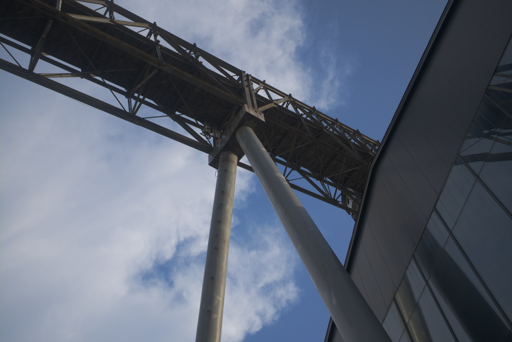 | 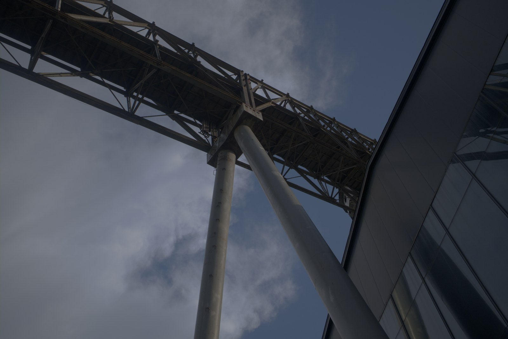 |

三处局部看差异：

**1. 桥底细节**（两者都把细节拉了出来，质感不同）：

| EV +1 | 中间调 +0.6 |
| --- | --- |
| 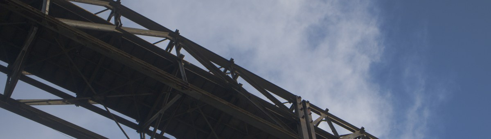 | 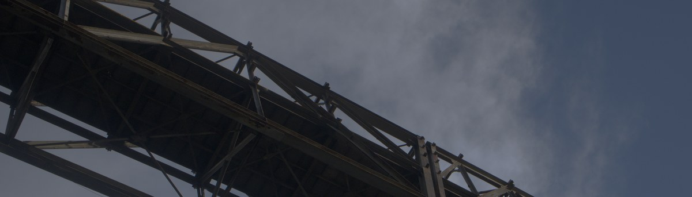 |

**2. 天空**（差距最明显：EV 一起变通透，中间调守住原位深沉情绪）：

| EV +1 | 中间调 +0.6 |
| --- | --- |
| 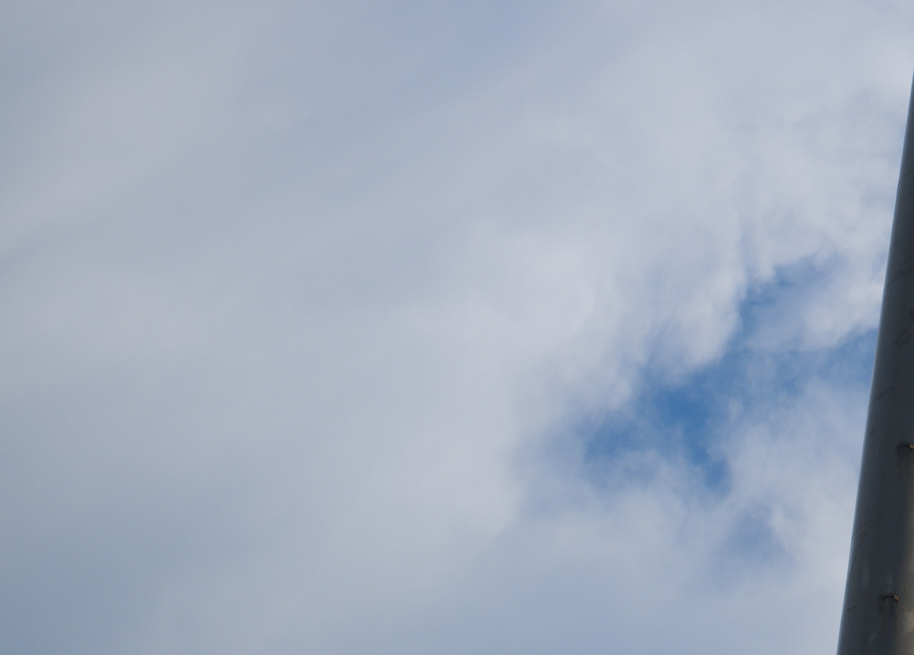 | 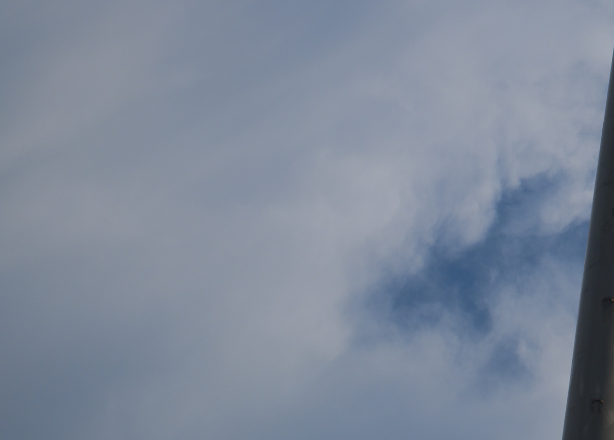 |

**3. 阴影明暗反差**（EV 拉开锈色与反光；中间调更收敛平整）：

| EV +1 | 中间调 +0.6 |
| --- | --- |
| 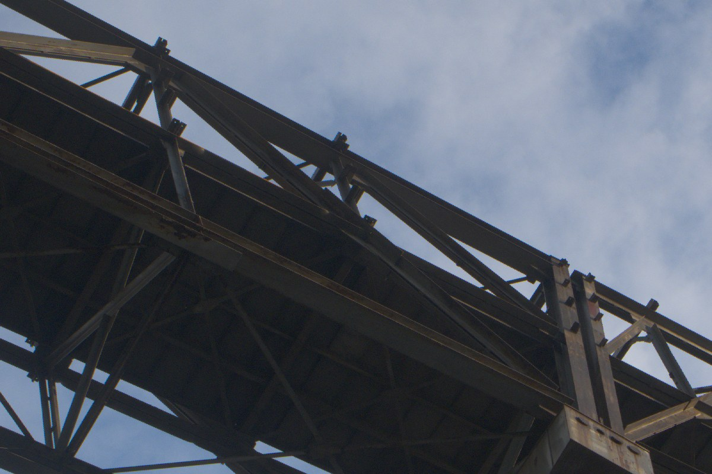 | 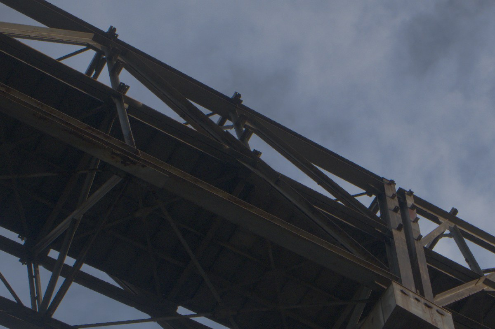 |

---

### 对照二：手办与灯（单用 vs 组合）

同一张图同时包含过曝灯盘和阴影主体，能把两种提亮的分工看得一清二楚：

| 默认 | 曝光 EV +0.7 |
| --- | --- |
|  | 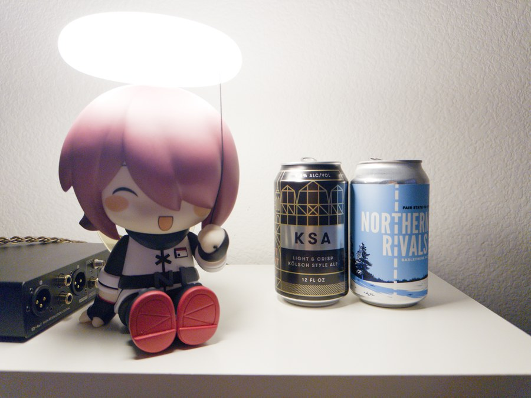 |
| **中间调 +0.8** | **组合：EV +0.3 + 中间调 +0.5** |
| 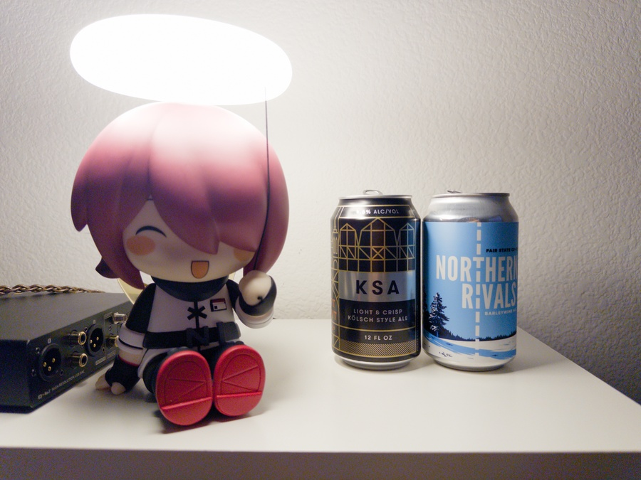 |  |

**主体特写（重点看红鞋与粉发）**：

| 默认 | 曝光 EV +0.7 |
| --- | --- |
| 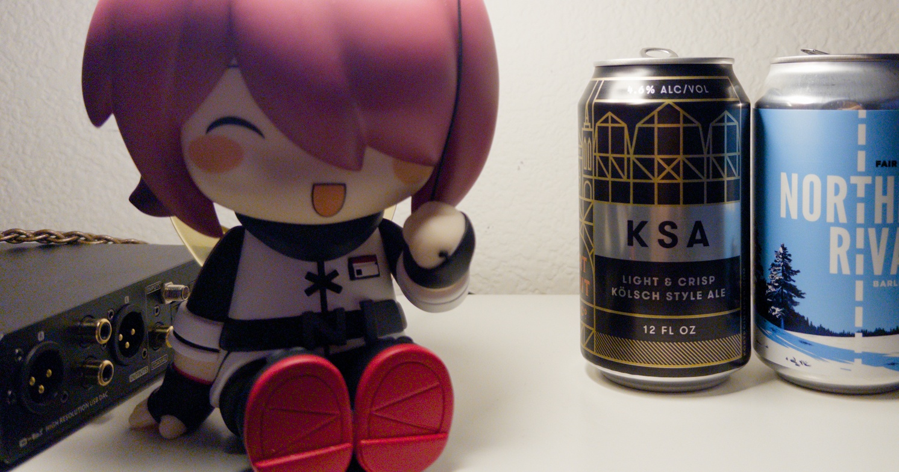 | 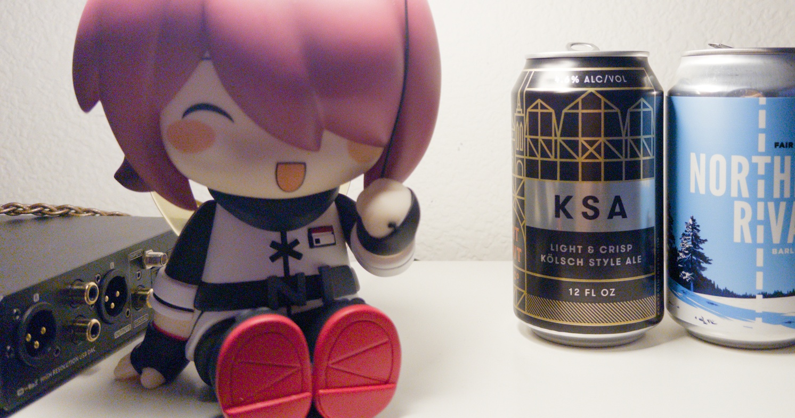 |
| **中间调 +0.8** | **组合：EV +0.3 + 中间调 +0.5** |
|  |  |

- **只用 EV +0.7**：主体提亮最多（线性亮度 `+0.44 档`，均值 `0.43 → 0.54`），但红鞋被推进高光褪白区，亮度 `0.21 → 0.33` 的同时饱和度从 `0.70` 跌到 `0.58`。
- **只用中间调 +0.8**：主体托起（均值 `0.43 → 0.47`），代价是粉发饱和度从 `0.59` 降到 `0.53`（交由第三步补回）。
- **组合（EV +0.3 + 中间调 +0.5）**：主体获得约三分之二的提亮（`+0.28 档`），红鞋到 `0.29` 且饱和度守在 `0.61`——**同等提亮幅度下，组合方案付出的颜色代价与光晕外扩都更小**。

**灯区特写（澄清对「中间调亮度」的三个常见误解）**：

| 默认 | 曝光 EV +0.7 |
| --- | --- |
| 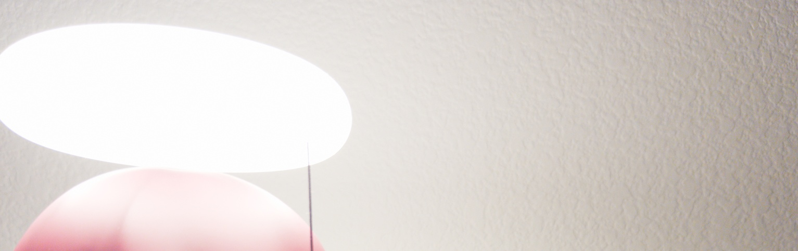 | 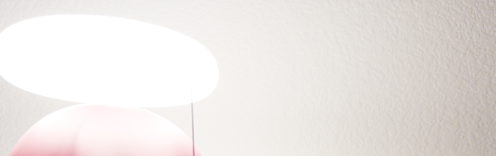 |
| **中间调 +0.8** | **组合：EV +0.3 + 中间调 +0.5** |
| 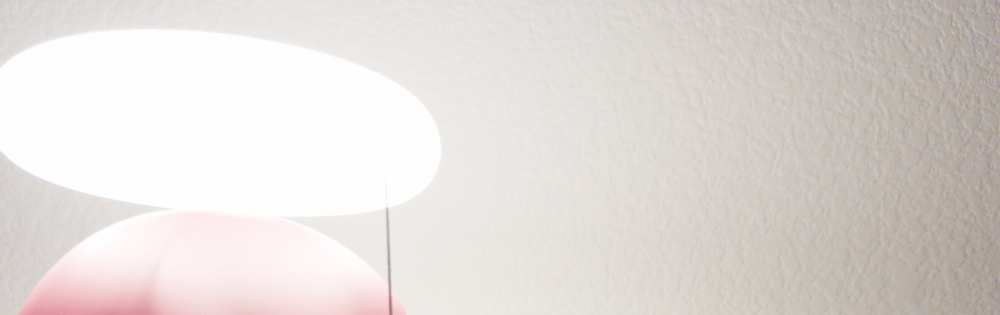 | 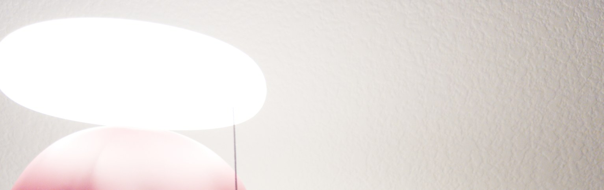 |

1. **它不是“弱化版 EV”**：纯 EV 让灯区均值从 `0.85` 涨到 `0.91`、光晕明显外扩；纯中间调仅 `0.85 → 0.87`，轮廓几乎与默认重合；组合版为 `0.85 → 0.89`，光晕外扩仅为纯 EV 的六成。
2. **它没有压暗高光**：灯盘亮度没有比默认更暗，只是留在原处没动。
3. **它也没有改变传感器过曝**：打开 RAW 过曝标记可见，四种设置下灯盘标记完全一致。

---

## 第三步 · 色彩补偿：色彩浓度与高光褪白

### 1. 色彩浓度（自动补偿的倍率）

**核心机制**：色彩浓度不是传统饱和度滑条。AgXRAW 会先按画面分析算出一个自动补偿值，滑条只是它的**倍率**（`1.0` = 原样应用自动值）。

样张一用中间调提亮后，蓝天发灰、铁锈发闷；把色彩浓度从 `1.0` 提到 `1.35`（该图上限）：

| 中间调 +0.6 · 浓度 1.0 | 中间调 +0.6 · 浓度 1.35 |
| --- | --- |
| 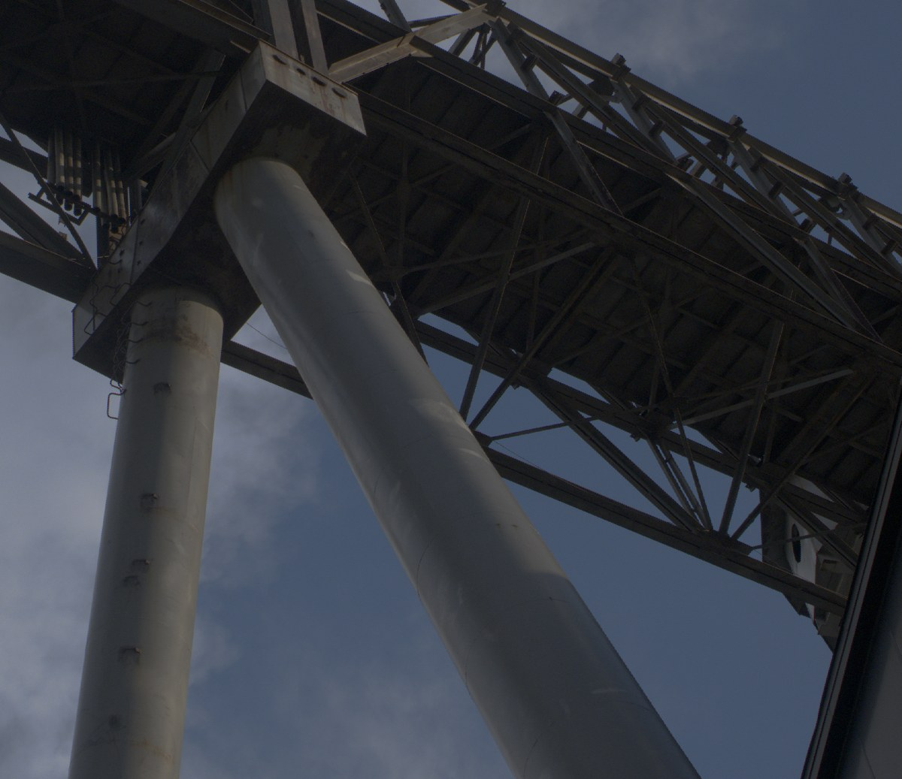 | 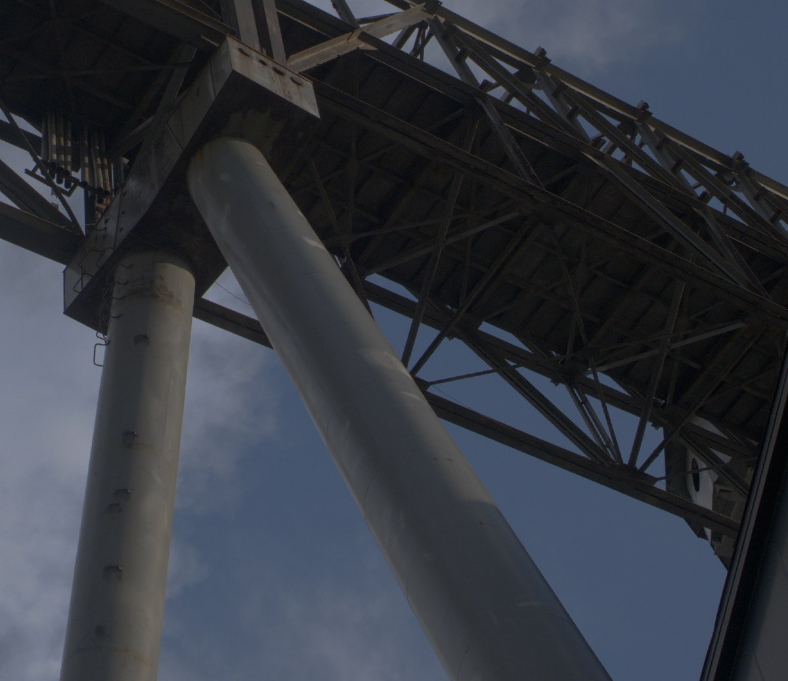 |

**看点**：蓝天与铁锈恢复了提亮前的鲜明度，明暗曲线完全未动。

两条使用边界：

- **只用 EV 提亮通常不需要补**：EV 不压扁中段反差，一般不会造成整体发灰。
- **为什么样张二拉满浓度毫无变化？** 航机厨房经分析判定无需补偿，自动值为 `0`；`0` 乘任何倍率仍是 `0`。滑条没坏，只是这张图用不上它。

### 2. 高光褪白（只作用于“又亮又有颜色”的像素）

颜色卡上的 **高光褪白** 只改接近屏幕纯白的**彩色像素**的饱和度（右拉更早褪白、左拉保留更多色彩），亮度完全不变。

- **何时有效**：画面里有晚霞云层、彩色灯罩、霓虹光晕等高亮彩色像素（拉满单通道最多变约 `15/255`，全图 99% 像素差不超过 `10/255`）。
- **何时无效**：白光灯盘、普通白墙等无色亮部上完全无变化。
- **HDR 下禁用**：HDR 的高光色彩由独立模型处理，选择 HDR 格式时该滑条自动置灰归零。

---

## 进阶参考：影调映射、高光模式与 HDR 读数

### 影调映射：同一条曲线，三种颜色策略

成像卡上的「影调映射」前三个选项共用**同一条明暗曲线**（黑白点、反差、弯度全同），区别只在：**颜色变亮时，要不要跟着褪淡向白过渡？**

| 选项 | 做法 | 观感与取舍 |
| --- | --- | --- |
| **AgX · 默认** | R/G/B 三通道各自过曲线 | 亮部自然褪淡过渡到白，有“发光感”且不刺眼；代价是高亮饱和色变淡、色相略偏 |
| **只压亮度 · 颜色不变** | 仅亮度过曲线，RGB 等比缩放 | 色彩完全忠实；代价是极亮饱和色生硬、过曝区过渡生硬 |
| **按 RAW 数据自动** | 亮度同上，颜色按 RAW 过曝/噪声逐像素在两者间选择 | 数据可靠处保留原色，过曝/高噪亮部交给 AgX（仅 LibRaw 可用） |
| **固定曲线 · 诊断** | 不看场景的固定曲线 | 仅作排查对照，不用于日常出片 |

Live house 紫色 LED 舞台灯（SIGMA fp，ISO 12800）同参数对比：

| AgX · 默认 | 只压亮度 · 颜色不变 | 按 RAW 数据自动 |
| --- | --- | --- |
| 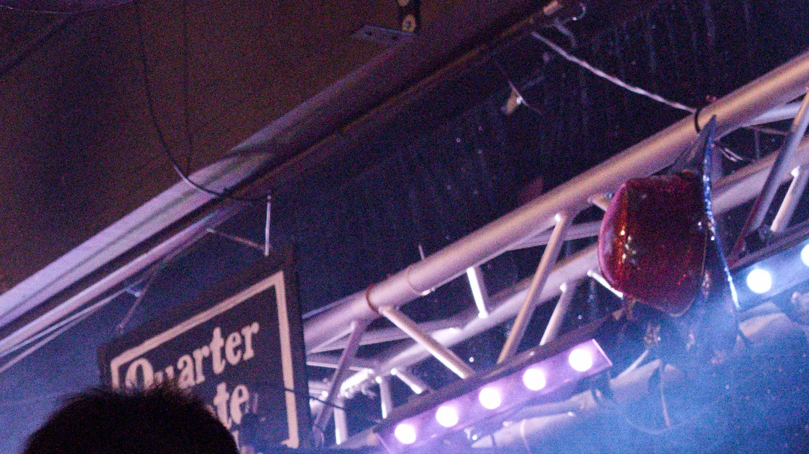 | 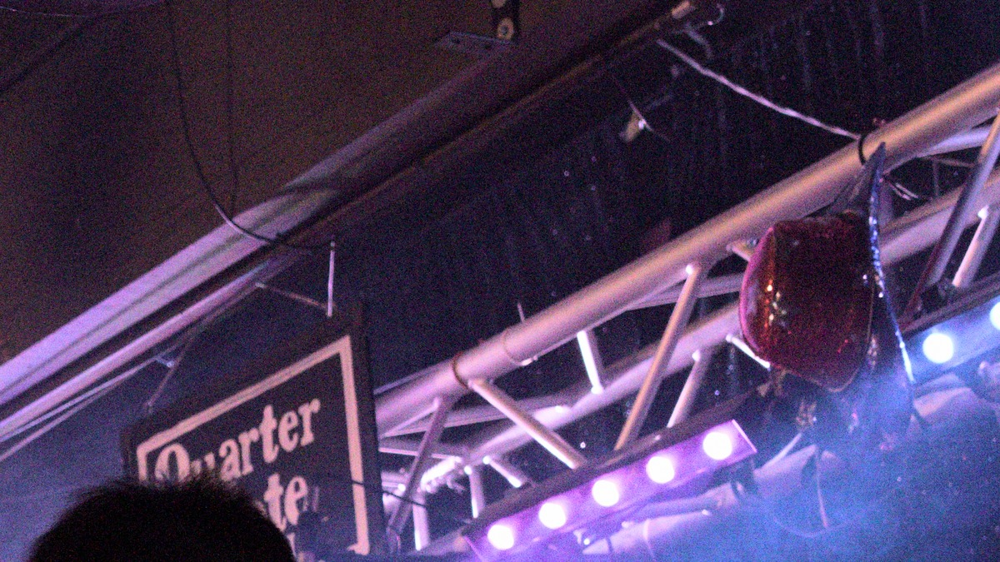 |  |

- **看点**：AgX 下灯珠褪为偏白淡紫、烟雾带一层青蓝，更有真实发光感；后两者保留浓郁紫色（高亮平均饱和度 `0.34` vs `0.40`，57% 像素任一通道差超过 `8/255`，平均亮度基本一致 `80.6` vs `77.4`）。
- **为什么第二、三张几乎一样**（可见差异像素仅 `0.002%`）？因为这盏灯虽然艳，但 RAW 实测并未过曝，「按 RAW 数据自动」判定绝大部分颜色可信，因此几乎全图保留原色。只有在大片真实过曝或高噪高光里，它才会明显转向 AgX。
- **怎么选**：默认用 **AgX**（也是 HDR 验证最充分的路径）；觉得霓虹/晚霞被洗得太淡时，可切 **按 RAW 数据自动** 对比。

---

### 高光模式：过曝像素怎么填进画面（仅 LibRaw）

RAW 解码卡上的「高光」决定传感器过曝像素以什么数值进入管线：

- **保持过曝（`clip`，默认）**：按上限裁切为纯白；
- **通道混合（`blend`） / 邻域重建（`reconstruct`）**：用未过曝通道推测原色。

**先说结论：多数照片三种模式几乎看不出差别。** 因为 AgXRAW 依靠解拜耳前的实测过曝记录控制高光衰减与 HDR 余量，不轻信填充值；传统软件里 `clip` 常见的品红镶边与色阶断层已被证据机制挡掉（实测整张存储卡 230 张照片中单/双通道过曝最高的场景，三种模式差异最多约 `11/255`）。

**能看出差别的场合**是只有部分通道过曝的平坦光源（如样张二航机厨房的顶灯板）：

| 保持过曝 clip | 通道混合 blend | 邻域重建 reconstruct |
| --- | --- | --- |
| 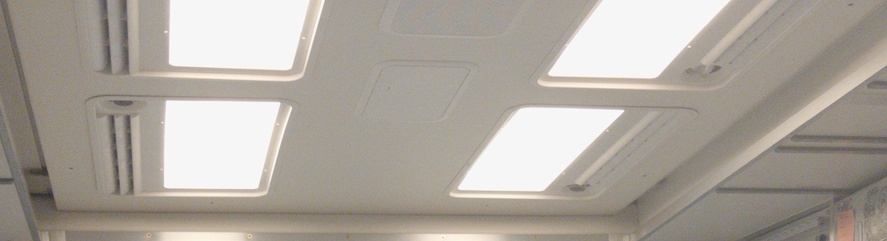 | 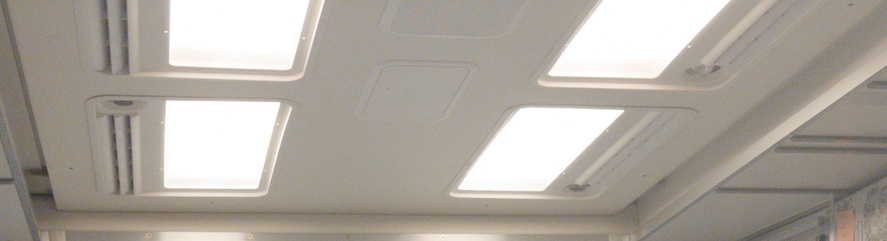 | 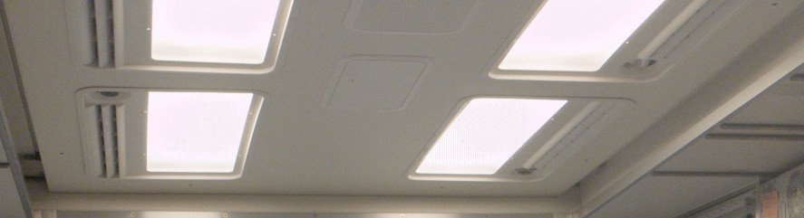 |

`clip` 呈现平实的白；`blend` 混出柔和偏暖过渡；`reconstruct` 推算更激进，但在柔光板上出现了**偏品红的误算色块**。日常保持默认 `clip` 即可；打开「RAW 过曝标记」看到平坦光源呈彩色标记（尚有未满通道）时，再按需尝试 `blend` 或 `reconstruct`。（Apple RAW 使用系统固定重建，不提供此开关。）

---

### 修图时怎么看 HDR 余量

> 完整导出步骤与真 HDR 样张见 [HDR 教程](HDR_TUTORIAL.zh-CN.md)；此处只讲界面读数含义。

- 样张三场景 EV 直方图上的 **`p99.99` 标线**（`+4.85 EV`）与输出卡旁的**「实测可靠尾部」**对应：它代表过曝之外传感器确实测到的最亮高光（已过曝像素不计入）。
- 扣除参考白亮度，得到**「场景可用余量」约 `+2.4 档`**；输出卡的「HDR 亮度上限」（默认 `+3.0`）只是天花板，最终取两者较小值（本图即 `+2.4 档`）。
- 测不出可靠高光时，直方图不画 `p99.99`，界面明确提示「可靠尾部不可用 · HDR 余量将为 0」，绝不拿估算值冒充实测。

---

## 全部滑条速查表

| 控件 | 改变什么 | 什么时候不动 / 注意事项 |
| --- | --- | --- |
| **黑白点依据** | 在「场景自适应」与「证据约束（噪声模型读噪底 / 可靠 RAW 尾部）」间切换曲线端点；中灰不变 | 单切过去暗部未必变亮，常需配合「暗部收黑」；高 ISO 下实测范围也可能比自适应更窄 |
| **暗部收黑** | 向左放缓暗部弯曲、抬出深阴影；向右更早沉黑 | 不动黑白点、中间调和高光 |
| **高光收白** | 向右放缓高光弯曲、留出亮部层次（亮区略暗）；向左更硬 | 曲线无肩部弯曲余地时纹丝不动（如样张一），看实测行确认 |
| **暗部过渡 / 高光过渡** | 在黑/白点不动的前提下微调两头曲率（拉满约 ±37%） | 有意极克制（约等于暗部收黑 0.6–0.7 档 / 高光收白 < 0.1 档），想见明显效果直接用收黑/收白 |
| **曝光 EV** | 画面沿横轴整体提亮/压暗，完整保留 AgX 反差与色彩 | 亮部会同步推向白点；可与「中间调亮度」叠加 |
| **中间调亮度** | 高光留原位，单独托起中间调与暗部 | 中段反差略平、颜色略淡；适合在 EV 定整体后补主体 |
| **中间调对比** | 围绕中灰调节中段反差斜率 | 通常在亮度定好后微调 |
| **色彩浓度** | 自动补偿值的倍率（`1.0` = 自动值），只加色彩不动明暗 | 画面自动值为 `0` 时拉满也无变化（如样张二）；开启胶片时置灰 |
| **高光褪白** | 调节接近纯白的**彩色像素**的褪白程度，亮度不变 | 无高亮彩色内容时无变化；HDR 输出时禁用 |
| **影调映射** | 同一条曲线下选择高光颜色策略：AgX / 只压亮度 / 按 RAW 数据自动 | 「按 RAW 数据自动」仅 LibRaw 可用，曝光正常时接近「只压亮度」；开启胶片时固定为 AgX |
| **高光模式** | 仅 LibRaw：过曝像素填值方式（`clip` / `blend` / `reconstruct`） | 多数照片差异极小，平坦光源可见区别；默认 `clip` 最稳妥 |
| **RAW 过曝标记** | 在预览图叠加 `≥97%` 满阱像素（R/G/B/白），本身不改画面 | 记录拍摄事实，不随 EV 变化；真实信息丢失看旁边的「完全过曝」占比；Apple RAW 下置灰 |

---

## 样张与数据说明

- 文中全部对比图由 AgXRAW 按所列参数全尺寸解码后缩放生成（自 2026-08-28 起由 `tools/regen_showcases.py` 按 `tools/showcase_manifests/editing_tutorial.json` 生成；全图长边 1600px，局部裁切为 1200px 原生像素），无任何后期修饰。两条曲线图由 `tools/plot_tone_curve_doc.py` 按实测渲染参数绘制。
- **如何自己核对数字**：网页界面各卡片的实测行展示当前生效值，导出后预览图上方的「导出报告」列出本次 SDR / HDR 导出的质量、采样、体积与回读结果；如需完整的传感器实测、曲线端点与矩阵健康度分析报告，请在命令行加上 `--report`（带 `--scan` / `--csv` 时自动附带）。
- **样张出处**：大逆光钢桥 `DSCF0214.RAF`（Fujifilm X100VI）、航机厨房与手办灯为 iPhone 16 Pro 标准 Bayer DNG、舞台灯 `_SDI0199.DNG`（SIGMA fp）。
