# 胶片教程：选一卷胶片时，画面里发生了什么

[返回首页](../README.zh-CN.md) · [修图教程](EDITING_TUTORIAL.zh-CN.md) · **胶片教程** · [HDR 教程](HDR_TUTORIAL.zh-CN.md) · [使用说明](USER_GUIDE.zh-CN.md) · [胶片模拟技术说明](FILM.zh-CN.md)

AgXRAW 的「胶片」卡片只有三个控件：**选哪卷胶片**、**颗粒强度**，以及**颗粒颜色**。这份教程讲清楚它们分别改变了画面的哪一部分；至于“这卷胶片适不适合这张照片”，由你的眼睛决定。

文中所有样张均由 AgXRAW 按图下命令实拍渲染（默认自动曝光、拍摄白平衡），所有数据均直接测自成片。肉眼难以分辨的细微项会直接说明，不放凑数的对比图。

| 样张 | 相机 | 演示重点 |
| --- | --- | --- |
| 一 · 寺庙 | SIGMA fp | 选胶片：天空与树叶在各卷间的差异 |
| 二 · 香港街景 | SIGMA fp | 三类胶片的分工：彩色负片、电影负片、反转片 |
| 三 · 猫吧黑猫 | SIGMA fp，ISO 3200 | 暗部与黑：每卷的黑从哪里“沉下去” |
| 四 · 树上的白松鼠 | Sony，原生 ARW | 按色相的颜色还原：同一片绿各自往哪走 |
| 五 · 清汤面碗 | SIGMA fp，ISO 12800 | 颗粒：各卷的粗细、颗粒滑杆与颗粒颜色 |

---

## 先理解一个前提：它是固定规则的渲染，不是后期滤镜

选中一卷胶片后，下面五个环节会同时切换为该胶片的数据，并且**在每张照片上执行完全一致的规则**（不看直方图、不随画面内容讨巧微调）：

1. **影调曲线**：该胶片印到相纸上（或反转片自身）的明暗关系，黑点对齐纸/片能达到的最深处；
2. **按色相颜色还原**：不同色相按各自规律偏转和收放饱和度，而非全图套一层色调；
3. **灰阶冷暖漂移**：中灰保持中性，暗部与亮部带上该胶片特有的轻微偏色；
4. **反转片测光中灰**：按 ISO 2240 标准测光定义，反转片中间调天然落得更深；
5. **密度域颗粒**：按数据手册颗粒度施加在负片染料密度上，再经特性曲线换回亮度。

> **界面联动规则**：开启胶片后，**影调映射、AgX 色彩浓淡、感色校正、色彩浓度**四项由胶片接管并置灰，关掉胶片后自动恢复原设置。曝光、白平衡与明暗卡的手动微调照常可用；胶片模式目前仅支持 SDR 输出。

---

## 一、选一卷胶片：同一张照片上的直观差异

| AgX（不选胶片） | Kodak Portra 400 |
| --- | --- |
|  |  |
| **Fujifilm Velvia 100** | **Kodak Vision3 250D** |
| 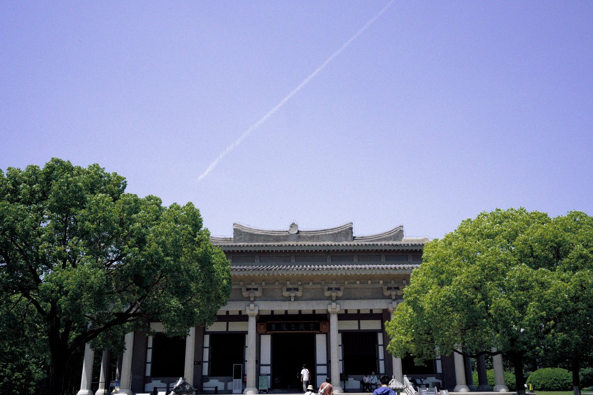 |  |
| **Kodak Ektar 100** | **Fujifilm Superia X-TRA 400** |
| 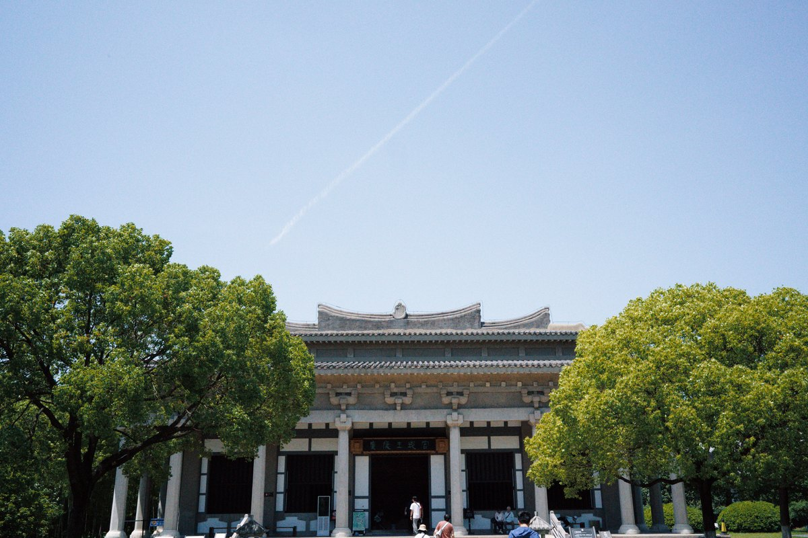 | 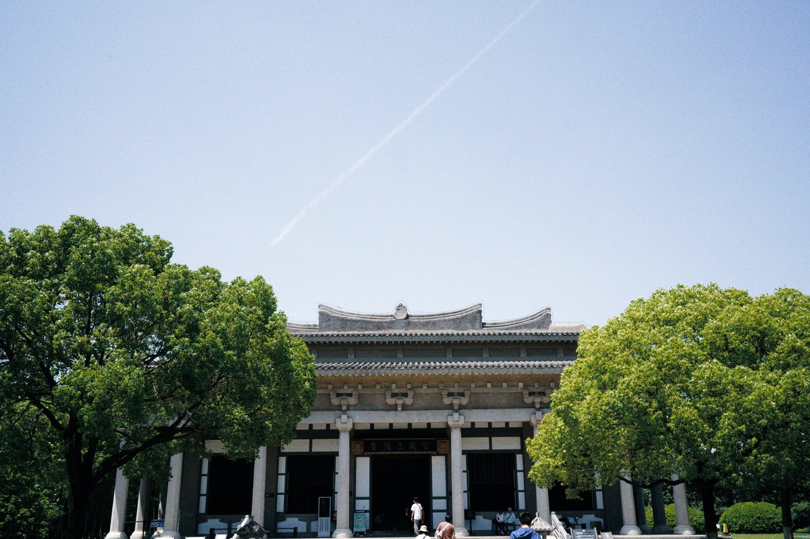 |

```bash
python -m dngscan _SDI0094.DNG --film portra400 --jpeg out.jpg
# 可替换为 velvia100 / vision3250d / ektar100 / superia400
```

**看点**：

- **差异集中在饱和色**（天空与树叶）：Portra 天空偏青、树叶偏黄绿；Velvia 天空浓而偏紫；Vision3 偏灰紫、整体最平；Superia 树叶明显偏向青绿。
- **中性色几乎不动**：白墙与灰瓦主要由曲线决定，各卷中灰落点一致（反转片除外，见下节）。
- **低饱和场景的差异**：夜景、阴天或室内色彩较少时，各卷差别主要体现在暗部反差与颗粒质感。

---

## 二、三类胶片：彩色负片、电影负片、反转片

胶片下拉列表按工艺分为三组：前两组是负片（需印放至相纸或拷贝才成片），第三组反转片冲出即成品。

| AgX（不选胶片） | Portra 400 · 彩色负片 |
| --- | --- |
| 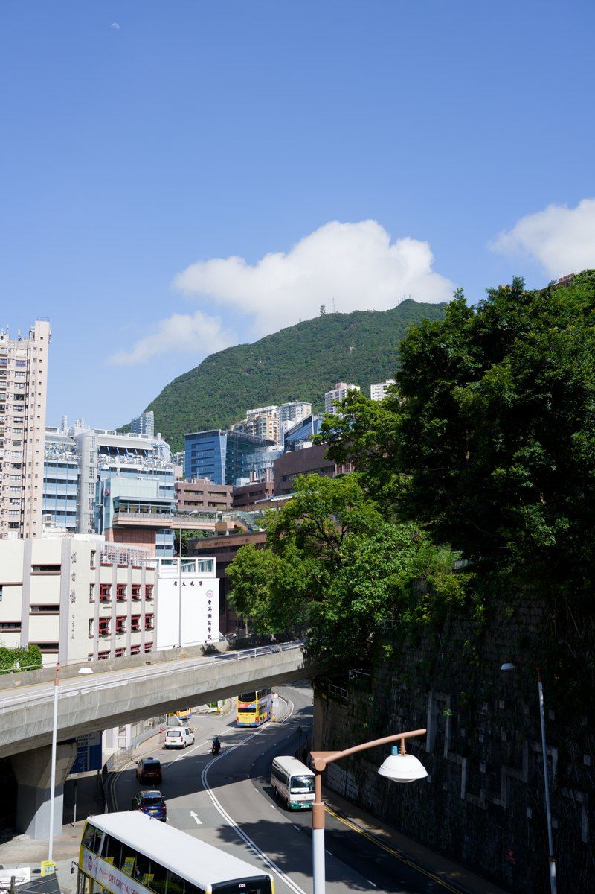 | 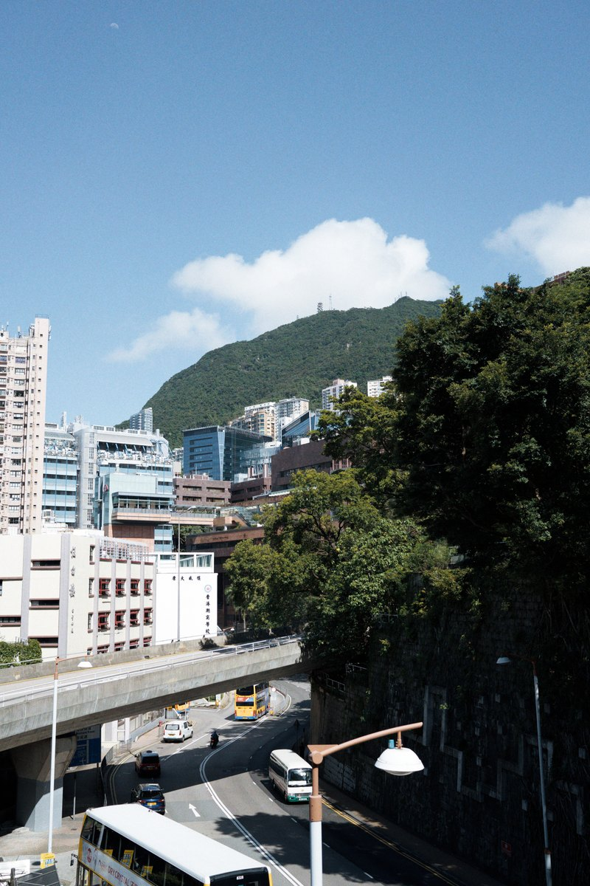 |
| **Vision3 250D · 电影负片** | **Provia 100F · 反转片** |
| 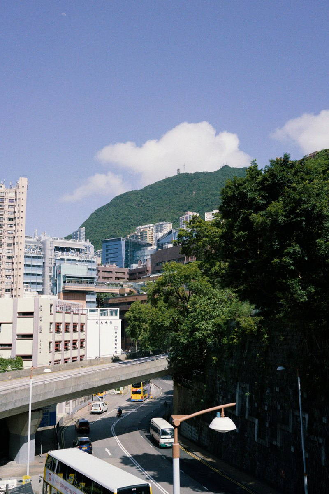 | 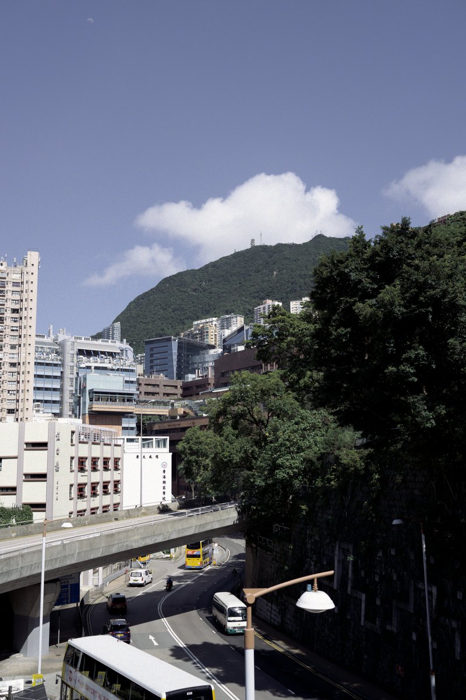 |

```bash
python -m dngscan _SDI0164.DNG --film provia100f --jpeg out.jpg
```

- **彩色负片**（Portra / Ektar / Gold / UltraMax / Superia / Pro 400H / C200）：印放环节会把灰卡印回中性灰，因此中间调亮度与 AgX 接近（本图中位码值：AgX `139`，Portra 400 `142`）。
- **电影负片**（Vision3 / Verita）：面向电影拷贝印放，曲线更长更平、高光收得更晚，整体观感最克制（本图中位 `134`）。
- **反转片**（Velvia / Provia / Ektachrome / Kodachrome）：没有印放校正环节，按 ISO 2240 测光定义中间调本就更深（Velvia `−0.27`、Provia `−0.41`、Ektachrome `−0.25`、Kodachrome `−0.29 EV`）。本图 Provia 中位降至 `117`，白墙与云层层次反而留得更厚实。自动曝光先在场景域完成，反转片测光偏移在其后施加，不会被自动曝光拉回去。

---

## 三、暗部与黑：每卷的黑从哪里“沉下去”

| AgX（不选胶片） | Kodak UltraMax 400 | Fujifilm Velvia 100 |
| --- | --- | --- |
|  |  | 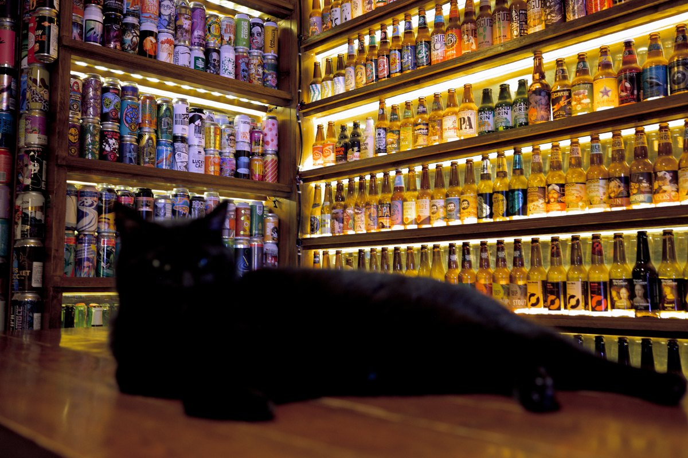 |

```bash
python -m dngscan _SDI0016.DNG --film velvia100 --jpeg out.jpg
```

经过黑点适应后，每卷胶片的纯黑都真正落地（不会浮起一层灰底），区别在于**暗部弯曲（趾部）有多陡**：

| 渲染 | 接近纯黑（码值 < 5）面积 | 暗部纹理起伏（9×9 邻域标准差） |
| --- | --- | --- |
| AgX（不选胶片） | 8.9% | 3.5 |
| UltraMax 400 | 8.2% | 3.3 |
| Velvia 100 | **22.0%** | **9.7** |

UltraMax、Portra 800 等高宽容度负片暗部接近 AgX；Velvia、Superia、C200 与增感 Portra 800 暗部更陡——黑猫与吧台大片沉入深黑，但未沉底处的毛发与木纹反差更鲜明（纹理起伏反而更高）。

---

## 四、颜色还原：同一片绿，各卷往哪边走

截取松鼠周围的树叶（原图中心裁切并缩小一半）：

| AgX（不选胶片） | Portra 400 | Superia 400 |
| --- | --- | --- |
| 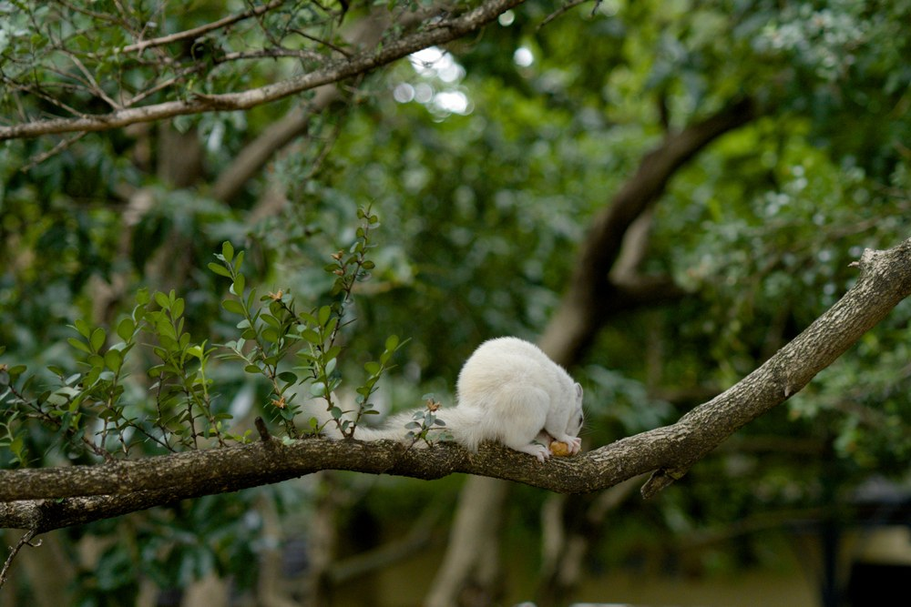 | 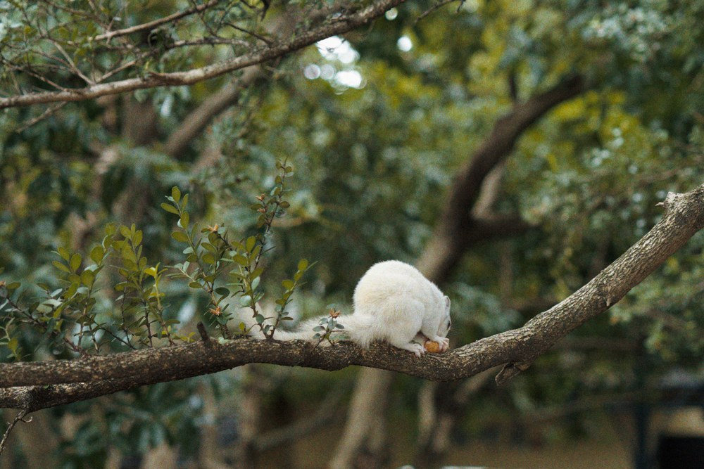 |  |
| | **Ektar 100** | **Kodachrome 64** |
| | 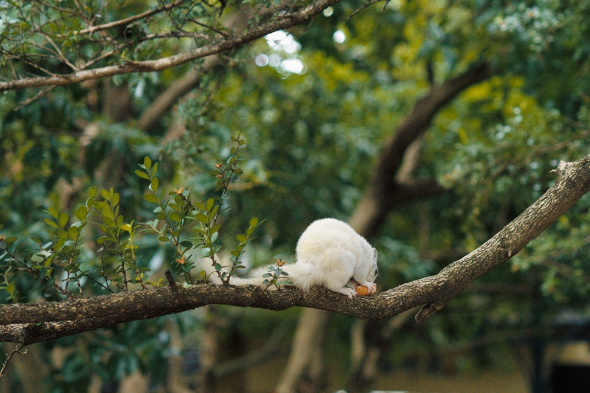 | 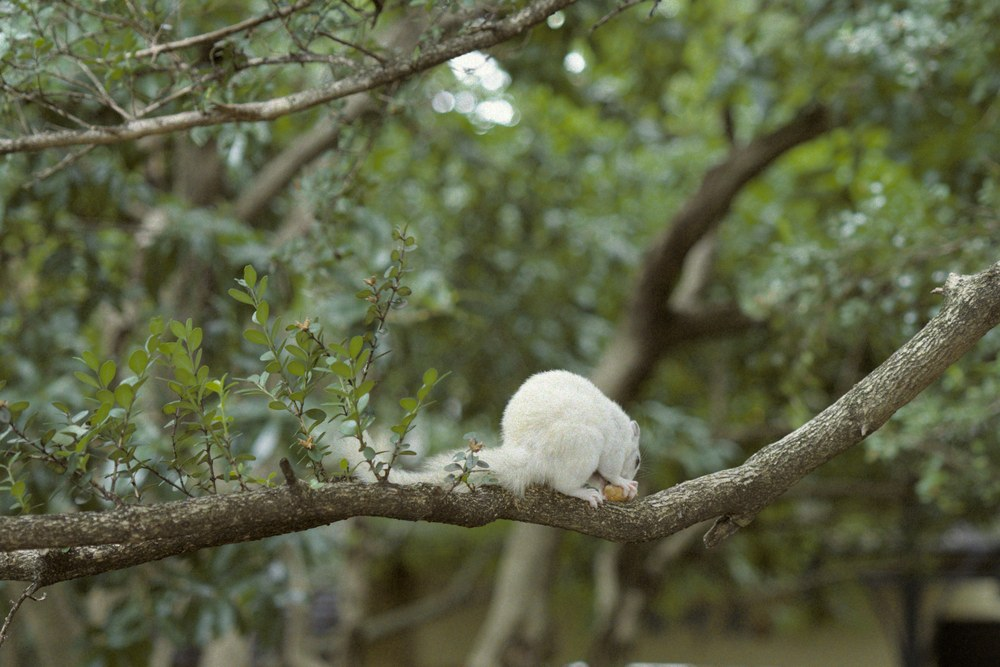 |

```bash
python -m dngscan DSC00225.ARW --film superia400 --jpeg out.jpg
```

每卷颜色还原由光谱模拟拟合而来：红、黄、绿、蓝各按自身方向移动。测得这片树叶的 CIELAB 绿色中位色相与平均彩度：

| 渲染 | 色相 | 彩度 |
| --- | --- | --- |
| AgX | 119° | 24.5 |
| Portra 400 | 116°（偏黄） | 18.9 |
| Superia 400 | 130°（偏青） | 21.3 |
| Ektar 100 | 123° | 22.5 |
| Kodachrome 64 | 114°（偏黄） | 19.4 |

全部胶片的平均饱和度与 AgX 持平，各卷相对浓淡直接来自数据（Ektar / Vision3 偏浓，Portra / Kodachrome 偏淡）。

> **关于灰阶冷暖漂移**：富士负片暗部略偏青绿、Kodachrome 亮部略偏暖、Velvia 暗部略偏冷，中灰保持中性。由于偏色主要集中在接近纯黑的暗端，在普通观看下非常克制，本文不另放对比图。

---

## 五、颗粒：粗细、强度与颜色

以下为 100% 原尺寸裁切（640×420 像素），平滑的失焦汤面最容易看清颗粒质感：

### 1. 不同胶片的原生颗粒度

| Ektar 100 | Portra 160 | Portra 400 | Portra 800 |
| --- | --- | --- | --- |
|  |  |  | 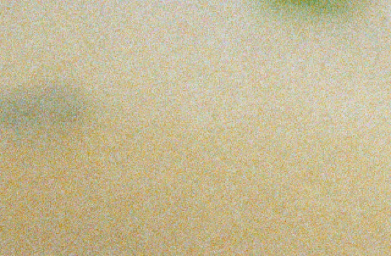 |

```bash
python -m dngscan _SDI0127.DNG --film portra800 --jpeg out.jpg
```

- **强度源自数据手册**：相对 Kodak 5207，Ektar `0.56`、Portra 160 `0.77`、Portra 400 `1.00`、Portra 800 `1.31`。上图中去掉大尺度明暗后的亮度标准差依次为 `4.7`、`5.6`、`6.2`、`6.9`（关闭颗粒时为 `4.3`，即 ISO 12800 自身传感器噪声）。
- **施加在染料密度上**：颗粒加在胶片密度域再经特性曲线换回亮度，因此在中间调最清晰，在纸白和深黑中自然收敛。
- **两级平滑颗粒场**：粗频带（18 µm）在 36×24 mm 片门上生成，细频带（6 µm）按输出像素尺寸逐行生成，均按 48 µm 光孔 RMS 标定，确保全尺寸导出与缩小预览颗粒感一致。

### 2. 颗粒强度滑杆（`--film-grain`）

`1.0` 为该胶片数据手册颗粒度，`0` 关闭，最高可调至 `3.0`：

| Portra 400 · 颗粒 0 | 颗粒 1.0（默认） | 颗粒 2.0 |
| --- | --- | --- |
| 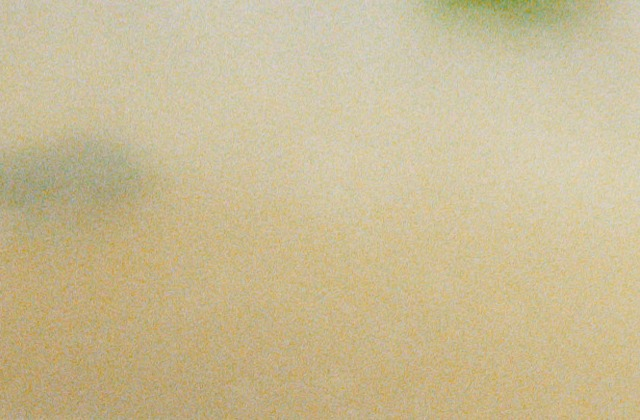 |  | 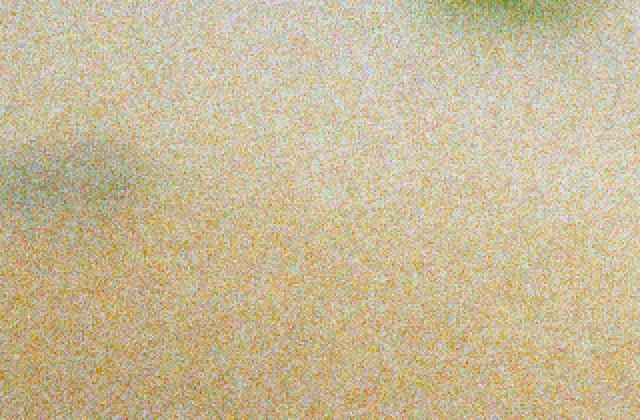 |

三块亮度起伏依次为 `4.3`、`6.2`、`9.8`，平均亮度保持不变（`187.6`、`187.6`、`187.4`）。颗粒排布由 RAW 文件内容唯一确定——同一张照片重复导出逐像素一致，换照片则不同。

### 3. 颗粒颜色（`--film-grain-chroma`）

控制三层乳剂颗粒之间的相关性：

| 胶片分层 · 带颜色（默认，`film`） | 扫描风格 · 以亮度为主（`scan`） |
| --- | --- |
|  |  |

彩色胶片三层乳剂物理上各自独立形成颗粒，因此**「胶片分层」**（层间相关 `0.35`）自带细腻彩噪；常见胶片扫描件颗粒多偏亮度，多来自扫描与后期处理，对应**「扫描风格」**（层间相关 `0.8`）。两者均为显式声明的惯例（厂方手册不提供层间相关数据）。上两块颜色起伏为 `10.8` vs `9.7`，亮度起伏 `6.2` vs `6.9`；在低 ISO 平滑蓝天上差别更直观。

---

## 全部 20 卷胶片速查

| 胶片 | CLI 名称（`--film`） | 类别 | 颗粒（相对 5207） | 测光中灰 |
| --- | --- | --- | --- | --- |
| Kodak Portra 160 / 400 / 800 | `portra160` / `portra400` / `portra800` | 彩色负片 | 0.77 / 1.00 / 1.31 | — |
| Kodak Portra 800 增感 1 / 2 档 | `portra800push1` / `portra800push2` | 彩色负片 | 1.31（手册无增感颗粒数据） | — |
| Kodak Ektar 100 | `ektar100` | 彩色负片 | 0.56 | — |
| Kodak Gold 200 | `gold200` | 彩色负片 | 1.17 | — |
| Kodak UltraMax 400 | `ultramax400` | 彩色负片 | 1.24 | — |
| Fujifilm Superia X-TRA 400 / Pro 400H / C200 | `superia400` / `pro400h` / `c200` | 彩色负片 | 1.00 | — |
| Kodak Vision3 50D / 200T / 250D / 500T | `vision350d` / `vision3200t` / `vision3250d` / `vision3500t` | 电影负片 | 0.70 / 1.00 / 1.00 / 1.12 | — |
| Kodak Verita 200D | `verita200d` | 电影负片 | 1.00 | — |
| Fujifilm Velvia 100 | `velvia100` | 反转片 | 0.98 | −0.27 EV |
| Fujifilm Provia 100F | `provia100f` | 反转片 | 0.98 | −0.41 EV |
| Kodak Ektachrome 100 | `ektachrome100` | 反转片 | 0.98 | −0.25 EV |
| Kodak Kodachrome 64 | `kodachrome64` | 反转片 | 1.22 | −0.29 EV |

颗粒倍率的出处与组间对接假设（Kodak 负片 PGI、富士负片 RMS 与 5207 间无公开换算）详见 [胶片模拟技术说明](FILM.zh-CN.md)。

---

## 本功能刻意不包含的内容

- **光晕（Halation）**：强光周围的红色光圈虽可由片基厚度与层序推出大小与色调，但各层反射光量在厂方数据中缺失；且这 20 卷均带防光晕层，真实光晕极弱，故不凭猜测添加。
- **冲洗、印相、色头、推拉冲旋钮**：胶片定位为固定规则的数据渲染，不提供逐步暗房调参。
- **HDR 输出**：胶片模拟目前仅支持 SDR。

> 胶片数据派生自 Andrea Volpato 的开源项目 [spektrafilm](https://github.com/andreavolpato/spektrafilm)（CC BY-SA 4.0），完整条款见 [第三方声明](../NOTICE.md)。
