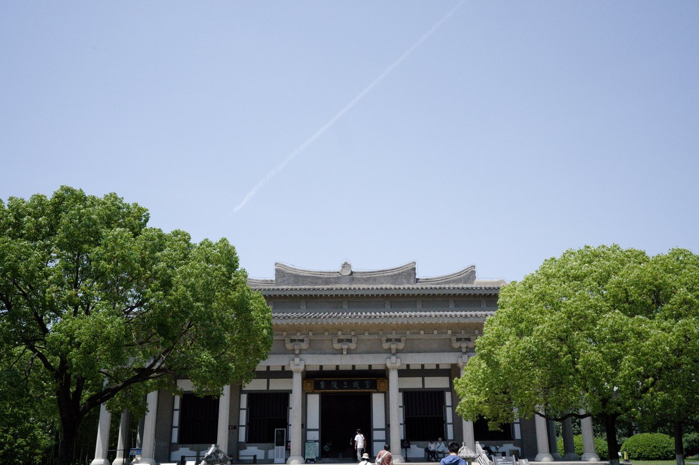
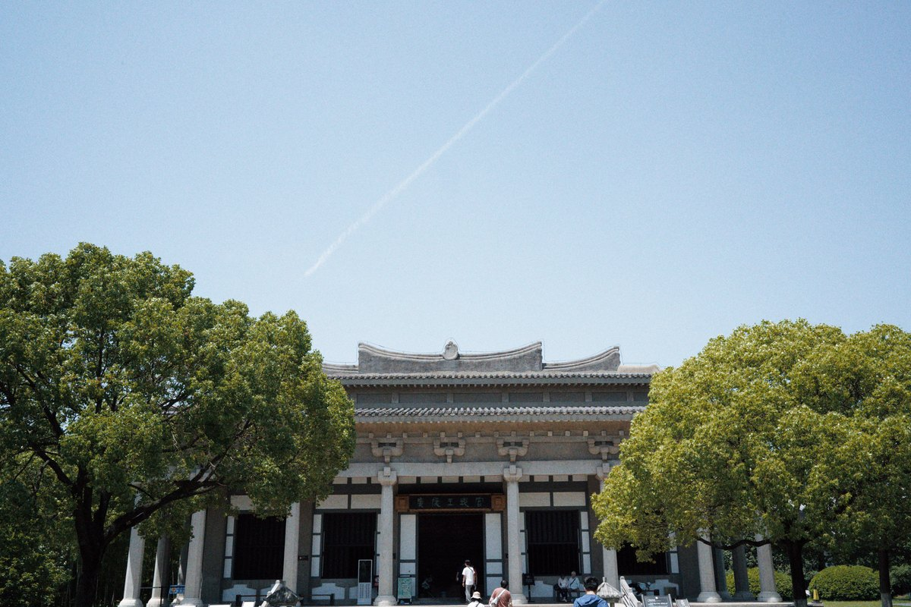
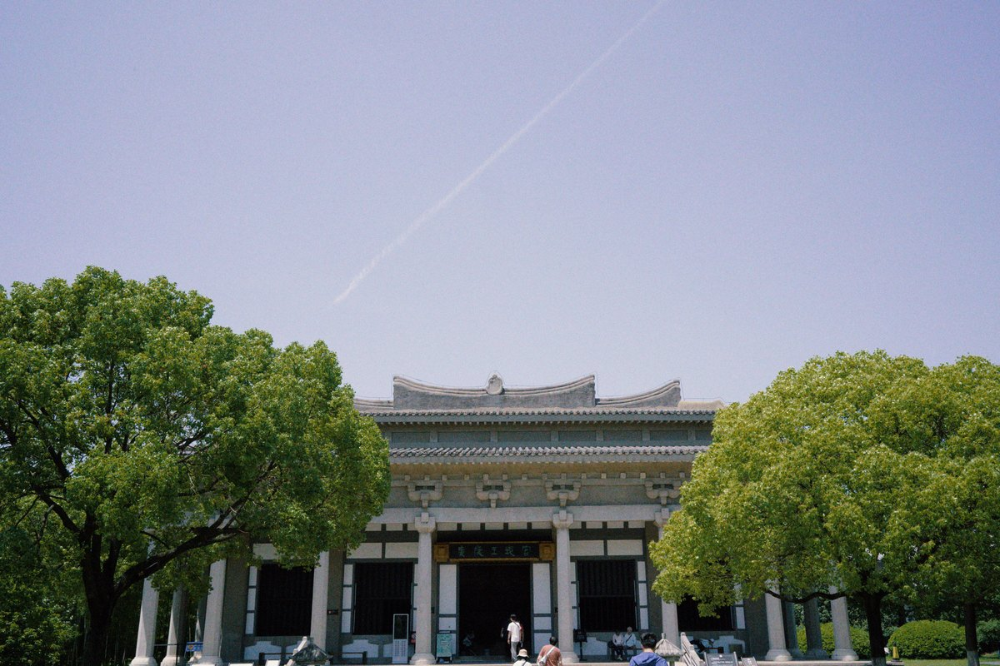
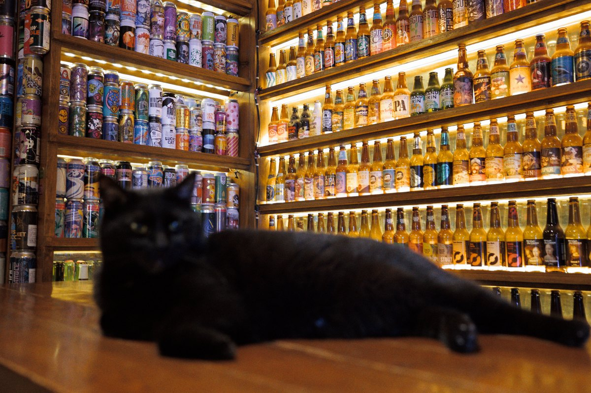
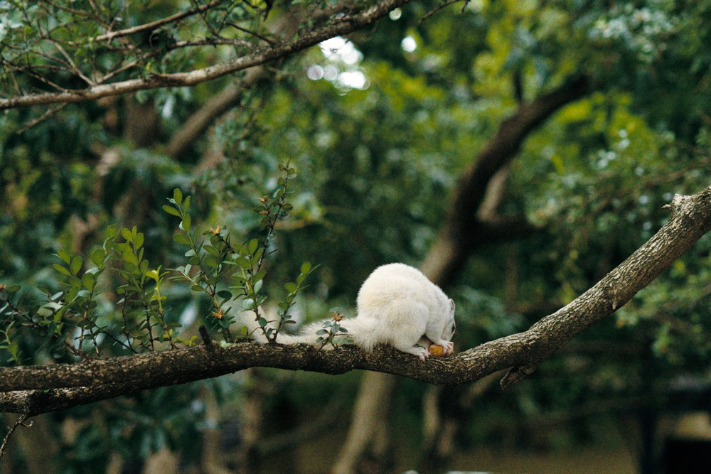
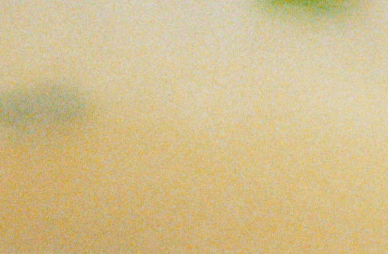
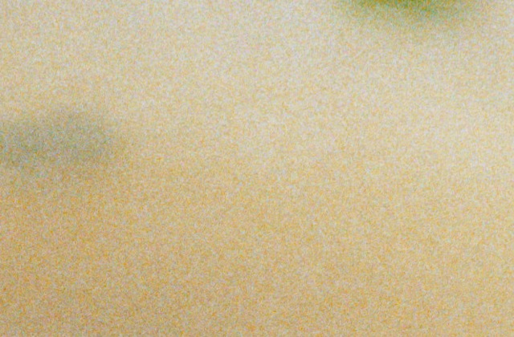
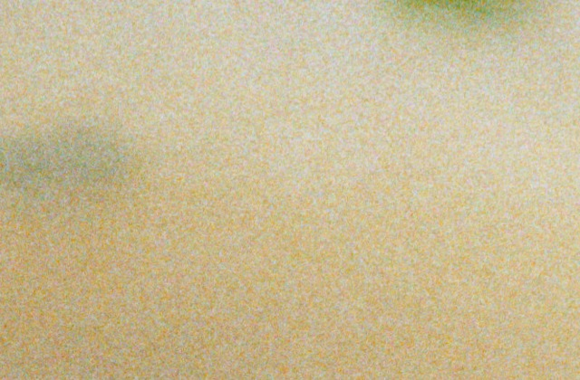
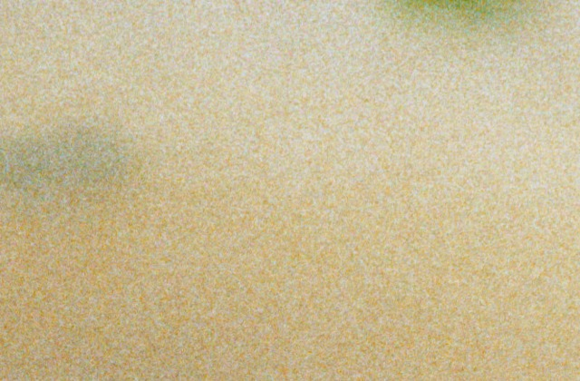

# 胶片教程 —— 选一卷胶片时，画面里发生了什么

[修图教程](EDITING_TUTORIAL.zh-CN.md) · [胶片教程](FILM_TUTORIAL.zh-CN.md) · [HDR 教程](HDR_TUTORIAL.zh-CN.md) · [使用说明](USER_GUIDE.zh-CN.md) · [胶片模拟技术说明](FILM.zh-CN.md)

AgXRAW 的胶片区只有两个控件：**选哪卷胶片**，以及**颗粒多粗**。这份教程讲清它们各自改变画面的哪一部分。"这卷胶片适不适合这张照片"由你的眼睛决定。

文中所有图都由 AgXRAW 按图下的命令实际渲染（自动曝光、拍摄白平衡，即默认设置），所有数字都来自对这些渲染结果的直接测量。效果在屏幕上看不出来的地方，本文会直接说明，不放凑数的对比图。

| 样张 | 相机 | 它演示什么 |
|---|---|---|
| 一 · 寺庙 | SIGMA fp | 选胶片：天空和树叶在各卷之间的差别 |
| 二 · 香港街景 | SIGMA fp | 三类胶片：彩色负片、电影负片、反转片 |
| 三 · 猫吧黑猫 | SIGMA fp，ISO 3200 | 暗部与黑：每卷的黑落在哪里 |
| 四 · 树上的白松鼠 | Sony，原生 ARW | 按色相的颜色还原：同一片绿，各卷往哪边走 |
| 五 · 清汤面碗 | SIGMA fp，ISO 12800 | 颗粒：各卷的粗细与颗粒滑杆 |

---

## 第零课 · 思路：一卷胶片是一套固定的渲染，不是滤镜

选中一卷胶片后，下面几件事都换成这卷胶片自己的数据，而且**在每张照片上按同一规则执行**——胶片不看直方图，也不随场景调整：

- **影调曲线**：这卷胶片印到相纸上（反转片则是幻灯片本身）的明暗关系，黑落在纸/片能达到的最深处；
- **颜色还原**：同一个颜色在这卷胶片上往哪个方向偏、浓还是淡，按色相分别处理；
- **灰阶的冷暖**：中灰保持中性，暗部和亮部带一点这卷胶片自己的偏色；
- **反转片的测光中灰**：按标准测光，反转片的中间调比负片印放出来的更深；
- **颗粒**：按这卷胶片数据手册公布的颗粒度，加在胶片的密度上。

因为这些都由胶片决定，选中胶片时**影调映射、AgX 色彩浓淡、感色校正、色彩浓度**四项会置灰；关掉胶片后自动恢复你原来的选择。曝光、白平衡、明暗卡上的手动调整照常可用。胶片目前只用于 SDR 输出。

---

## 一 · 选一卷胶片：同一张照片上的差别

| AgX（不选胶片） | Kodak Portra 400 |
|---|---|
|  |  |
| **Fujifilm Velvia 100** | **Kodak Vision3 250D** |
|  |  |
| **Kodak Ektar 100** | **Fujifilm Superia X-TRA 400** |
|  |  |

```bash
python -m dngscan _SDI0094.DNG --film portra400 --jpeg out.jpg   # 换成 velvia100 / vision3250d / ektar100 / superia400
```

差别最大的是**天空**和**树叶**这两类颜色：Portra 的天空偏青，Velvia 的天空浓而偏紫，Vision3 偏灰紫、整体最平；树叶在 Portra 上偏黄绿，在 Superia 上偏青绿。建筑的白墙和灰瓦几乎不变——中性色由曲线决定，各卷的中灰都落在同一处（反转片除外，见第二课）。颜色越鲜艳，各卷之间分得越开；照片里颜色少的时候（夜景、室内、阴天），各卷主要差在明暗和颗粒。

---

## 二 · 三类胶片：彩色负片、电影负片、反转片

胶片选单按冲洗方式分成三组。前两组是负片，要再印到相纸上才是成片；反转片（幻灯片）冲出来直接就是成片。

| AgX（不选胶片） | Portra 400 · 彩色负片 |
|---|---|
|  |  |
| **Vision3 250D · 电影负片** | **Provia 100F · 反转片** |
|  |  |

```bash
python -m dngscan _SDI0164.DNG --film provia100f --jpeg out.jpg
```

- **彩色负片**（Portra、Ektar、Gold、UltraMax、Superia、Pro 400H、C200）：印放时把灰卡印成灰，所以中间调的亮度和不选胶片时接近——这张的中位亮度 AgX 是 139，Portra 400 是 142（8-bit 码值）。
- **电影负片**（Vision3、Verita）：配电影拷贝印放，曲线更长、更平，高光收得更晚，整体最"淡"——中位 134。
- **反转片**（Velvia、Provia、Ektachrome、Kodachrome）：没有印放这一步，标准测光时中间调本来就落得更深。AgXRAW 按 ISO 2240 的测光定义从每卷的曲线上算出它自己的中灰：Velvia −0.27、Provia −0.41、Ektachrome −0.25、Kodachrome −0.29 EV。这张 Provia 的中位降到 117，白墙和云的层次因此保留得更多。自动曝光不会把它拉回去——自动曝光看的是场景本身，胶片的测光在它之后执行。

---

## 三 · 暗部与黑：每卷的黑落在哪里

| AgX（不选胶片） | Kodak UltraMax 400 | Fujifilm Velvia 100 |
|---|---|---|
|  |  |  |

```bash
python -m dngscan _SDI0016.DNG --film velvia100 --jpeg out.jpg
```

每卷胶片的黑都对齐到相纸或幻灯片能达到的最深处（不再是一层灰底），区别在**暗部从多暗开始"沉下去"**。这是曲线趾部的形状，由胶片数据决定：

| | 接近纯黑（码值 < 5）的面积 | 暗部纹理起伏 |
|---|---|---|
| AgX | 8.9% | 3.5 |
| UltraMax 400 | 8.2% | 3.3 |
| Velvia 100 | 22.0% | 9.7 |

UltraMax、Portra 800 这类宽容度大的负片，黑区和 AgX 差不多；Velvia、Superia、C200 和增感的 Portra 800 暗部最陡，黑猫和吧台暗处大片沉下去，但沉下去的地方仍看得出毛发和木纹——暗部纹理起伏（暗部 9×9 邻域的标准差）反而更大。低调场景下哪一种合适，交给你判断。

---

## 四 · 颜色还原：同一片绿，各卷往哪边走

截取松鼠周围的树叶（原图的中间一块，缩小一半）：

| AgX（不选胶片） | Portra 400 | Superia 400 |
|---|---|---|
|  |  |  |
| | **Ektar 100** | **Kodachrome 64** |
| |  |  |

```bash
python -m dngscan DSC00225.ARW --film superia400 --jpeg out.jpg
```

每卷胶片的颜色还原来自它的光谱模拟：同一个绿，在不同胶片上色相和浓淡都不同，而且红、黄、蓝各自往不同方向走，不是整体加一层色调。这片树叶（CIELAB 中绿色像素的中位色相与平均彩度）：

| | 色相 | 彩度 |
|---|---|---|
| AgX | 119° | 24.5 |
| Portra 400 | 116°（偏黄） | 18.9 |
| Superia 400 | 130°（偏青） | 21.3 |
| Ektar 100 | 123° | 22.5 |
| Kodachrome 64 | 114°（偏黄） | 19.4 |

全部胶片的平均饱和度与 AgX 相同，各卷之间的相对浓淡来自数据：Ektar、Vision3 偏浓，Portra、Kodachrome 偏淡。

**灰阶的冷暖**也在这一步：每卷胶片的暗部和亮部带一点自己的偏色（富士负片暗部偏青绿、Kodachrome 亮部偏暖、Velvia 暗部偏冷），中灰保持中性。这项在屏幕上很弱——偏色集中在很暗的地方，那里已经接近纯黑——本文不单独放图。

---

## 五 · 颗粒：粗细由胶片决定，滑杆调整强度

汤面这一块是 100% 原尺寸截取（640×420 像素）；景深外的汤面很平滑，最容易看清颗粒：

| Ektar 100 | Portra 160 | Portra 400 | Portra 800 |
|---|---|---|---|
|  |  |  |  |

```bash
python -m dngscan _SDI0127.DNG --film portra800 --jpeg out.jpg
```

颗粒按每卷胶片数据手册公布的颗粒度定强度（相对 Kodak 5207：Ektar 0.56、Portra 160 0.77、Portra 400 1.00、Portra 800 1.31），加在胶片的染料密度上，再经这卷胶片自己的曲线换回亮度——所以颗粒在中间调最明显，在纸白和深黑里自然收敛。上面四块的亮度起伏（去掉大尺度明暗后的标准差，8-bit 码值）：Ektar 4.7、Portra 160 5.6、Portra 400 6.2、Portra 800 6.9；作为对照，颗粒关闭时这块是 4.3，那是 ISO 12800 的传感器噪声。颗粒是平滑连续的颗粒场：粗的一级（18 µm）在 36×24 mm 片门上生成，细的一级（6 µm）按输出像素的实际尺寸生成，两者都按 48 µm 光孔的颗粒度标定，所以全尺寸导出和缩小的预览颗粒强度一致。

**颗粒滑杆**（GUI 胶片卡片，命令行 `--film-grain`）在这卷胶片的颗粒度上整体缩放。1.0 是数据手册的颗粒度，0 关闭：

| Portra 400 · 颗粒 0 | 颗粒 1.0（默认） | 颗粒 2.0 |
|---|---|---|
|  |  |  |

起伏依次是 4.3、6.2、9.8。颗粒的排布由 RAW 文件本身决定：同一张照片的导出与重新导出完全一致，换一张照片排布就不同；预览里粗的一级与导出相同，细的一级按预览自己的像素生成。颗粒不改变平均亮度（三块的平均码值 187.6、187.6、187.4）。

**颗粒颜色**（GUI 胶片卡片，命令行 `--film-grain-chroma`）决定三层颗粒之间的相关程度：

| 胶片分层 · 带颜色（默认） | 扫描风格 · 以亮度为主 |
|---|---|
|  |  |

彩色胶片的三层乳剂各自形成颗粒，物理上互相独立，所以"胶片分层"的颗粒带颜色；我们熟悉的胶片扫描件里颗粒多以亮度为主，那主要来自扫描与后期处理。两档都是声明的惯例（层间相关 0.35 与 0.8），厂方数据只给每层的颗粒度，不给层间相关。这两块的颜色起伏是 10.8 与 9.7，亮度起伏 6.2 与 6.9；在低 ISO 的平滑天空上差别更明显。

---

## 全部胶片一览

| 胶片 | 类别 | 颗粒（相对 5207） | 测光中灰 |
|---|---|---|---|
| Kodak Portra 160 / 400 / 800 | 彩色负片 | 0.77 / 1.00 / 1.31 | — |
| Kodak Portra 800 增感 1 / 2 档 | 彩色负片 | 1.31（手册无增感颗粒数据） | — |
| Kodak Ektar 100 | 彩色负片 | 0.56 | — |
| Kodak Gold 200 | 彩色负片 | 1.17 | — |
| Kodak UltraMax 400 | 彩色负片 | 1.24 | — |
| Fujifilm Superia X-TRA 400 / Pro 400H / C200 | 彩色负片 | 1.00 | — |
| Kodak Vision3 50D / 200T / 250D / 500T | 电影负片 | 0.70 / 1.00 / 1.00 / 1.12 | — |
| Kodak Verita 200D | 电影负片 | 1.00 | — |
| Fujifilm Velvia 100 | 反转片 | 0.98 | −0.27 EV |
| Fujifilm Provia 100F | 反转片 | 0.98 | −0.41 EV |
| Kodak Ektachrome 100 | 反转片 | 0.98 | −0.25 EV |
| Kodak Kodachrome 64 | 反转片 | 1.22 | −0.29 EV |

颗粒倍率的来源与组间对接假设（Kodak 负片的 PGI、富士负片的 RMS 与 5207 之间没有公开换算）见[胶片模拟技术说明](FILM.zh-CN.md)。

---

## 没有的东西

- **光晕（halation）**：强光周围的红色光圈来自片基背面的反射。它的大小和偏红可以从胶片结构推出，但强度在厂方数据里没有；这些胶片都有防光晕层，真实光晕本就很弱，所以没有加。
- **冲洗、印相、色头、推拉冲**：胶片是一套固定渲染，没有逐步显影的旋钮。
- **HDR 输出**：胶片目前只用于 SDR。

胶片数据派生自 Andrea Volpato 的开源项目 [spektrafilm](https://github.com/andreavolpato/spektrafilm)（CC BY-SA 4.0），见[第三方声明](../NOTICE.md)。
