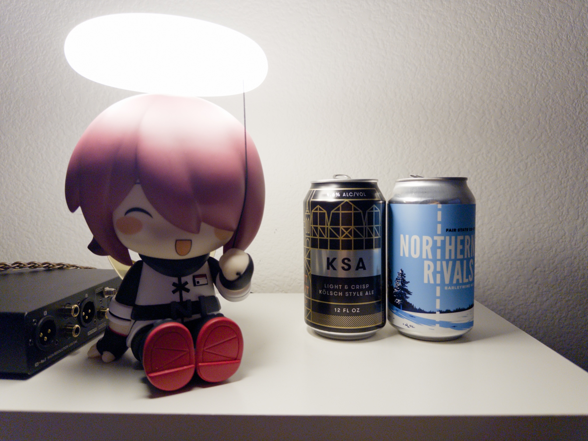
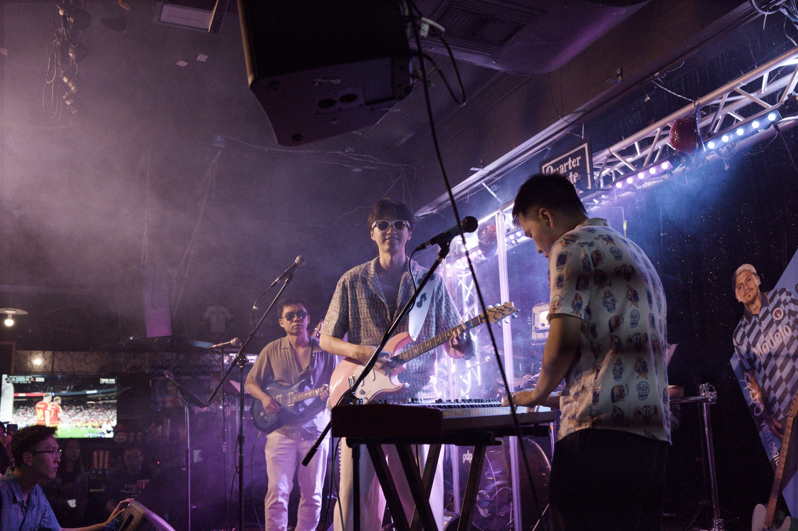
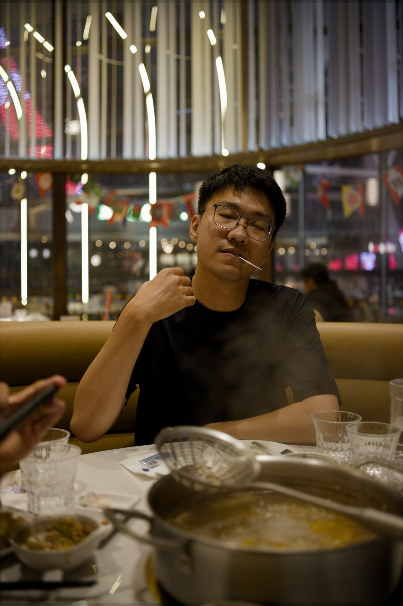
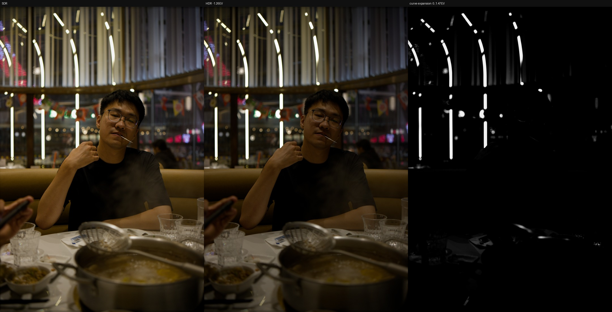
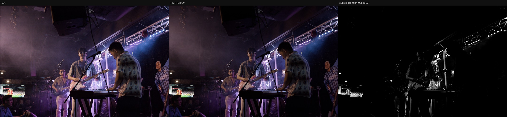

# HDR 教程：HDR 照片是什么、能亮多少、怎么导出

[返回首页](../README.zh-CN.md) · [修图教程](EDITING_TUTORIAL.zh-CN.md) · [胶片教程](FILM_TUTORIAL.zh-CN.md) · **HDR 教程** · [使用说明](USER_GUIDE.zh-CN.md) · [技术架构](ARCHITECTURE.zh-CN.md)

这份教程讲清楚四件事：**HDR 照片到底是什么**、**一张照片凭什么能亮几档**、**为什么 AgXRAW 不是“把普通照片拉亮”**，以及**如何导出并确认文件可靠**。

---

## 一、HDR 照片是什么

普通照片（SDR）最亮只能到屏幕的“正常白色”（网页底色、文档白纸那种亮度），下文称**参考白**。现实中远比白纸亮的灯光、太阳与镜面反光，在普通照片里只能被压到和白纸一样亮。

**HDR 照片允许这些高亮部分真正亮于参考白。** 在支持 HDR 的屏幕上，灯光会显得真的在发光，而不是一块死白。

AgXRAW 导出的 HDR 照片（ISO 增益图格式）在**同一个文件**里打包了两样东西：一张完整可用的普通版照片，加一张记录“哪里该更亮、亮多少”的**增益图（Gain Map）**。

- **支持 HDR 的屏幕与软件**：两者合成显示，高光真正亮起来；
- **不支持的设备或应用**：无缝显示其中的普通版，不会发灰、偏色或报错。

### 直接在页面上看真 HDR 样张

下面三张是 AgXRAW 导出的**真 HDR 文件**（除长边缩至约 2000px 外，与正常导出完全一致）。如果你的屏幕与浏览器支持 HDR（Mac / iPhone 的 Safari 或 Chrome、Android 15+ 的 Chrome），灯光与高光会明显亮于页面白底；若看不出区别，说明当前环境自动退回显示了内嵌普通版。

| 手办与灯 · 比参考白亮 2.35 档 | 舞台灯 · 亮 1.35 档 |
| --- | --- |
|  |  |

| 餐厅灯管 · 亮 1.45 档 |
| --- |
|  |

---

## 二、一张照片能比普通照片亮多少？

HDR 相对参考白多出的亮度叫 **HDR 余量**，它严格取下面三个上限里的**最小值**：

1. **传感器确实测到的最亮高光（`p99.99`）**：只统计过曝之前真实记录到的信号。已经过曝的像素不算，靠高光重建推算出来的像素也不算（对应界面检测参数卡的「可信最亮高光」与「HDR 可用余量」）。
2. **你设定的「HDR 亮度上限」**：输出卡滑杆，默认 `+3.0 档`（约对应 800 nit 屏幕）。它是**天花板，不是目标值**。
3. **曲线本身的平滑过渡**：HDR 高光同样要平滑收束到峰值，不能生硬截断。

以实拍为例：

- **手办与灯**：场景 EV 直方图 `p99.99` 为 `+4.85 档`，扣除参考白得到约 `+2.4 档` 可用余量，小于上限 `+3.0`，最终实际使用约 `+2.4 档`。
- **餐厅灯管**：可信最亮高光 `+3.94 档`，计算余量 `1.47 档`，写入并回读验证为 `1.447 档`。

> **没有测到真实高光怎么办？**
> 当可用余量为 `0` 时，导出 HDR 会直接报错而不是硬造亮度。本来就没有高亮元素的画面做成 HDR 也不会有任何区别，直接导出普通 SDR 即可。

---

## 三、不是“把普通照片拉亮”，而是独立成像

很多工具的 HDR 做法是先出普通照片，再把亮部等比放大。AgXRAW 不这样做：**普通版（SDR）与 HDR 版从同一份线性场景数据出发，各自独立成像**——共享曝光与 RAW 证据，但 HDR 版拥有自己的高光曲线与高光色彩模型，不以成品 SDR 为输入。

下面两张对照图从左到右依次为：① 普通版、② 压回普通范围供观察的独立 HDR 版、③ **亮度分配图**（越亮表示该处分得的 HDR 余量越多，纯黑表示亮度与普通版一致）：





**看点**：HDR 余量只精准分配给灯管、玻璃反光点、LED 灯珠、反光桁架和屏幕；人脸、衣物、背景墙与暗部在分配图里几乎全黑——意味着主体与阴影保持原貌，不会被顺手拉亮。

### 很亮的灯在 HDR 里是什么颜色？

在 HDR 分支中，亮度与颜色分开裁决：亮度完全听从 HDR 曲线，颜色则受逐像素传感器可靠性约束——**越亮、越接近过曝的光源，越趋向干净的白，避免发出刺眼的假彩色**。普通版不受此规则影响。

---

## 四、怎么导出与查看

> **平台要求**：HDR 增益图写入依赖 macOS 系统编码组件。网页界面启动时会自动检测一次，环境不支持时 HDR 格式会置灰并写明原因。另外，**开启胶片模拟时暂不支持 HDR 输出**。

### 1. 选择格式与导出档位

在输出卡中选择格式：

- **HDR gain-map · JPEG（推荐）**：兼容性最广，文首三张样张均为此格式。
- **HDR gain-map · HEIC**：同内容换用 HEIC 容器；安装了带 x265 的 `libheif` 后支持 10-bit 浮点母版编码，体积与色度保真各有取舍（详见 [质量与体积实测](DELIVERY_QUALITY_STUDY.zh-CN.md)），需要 HEIC 时再选。

再选导出档位（仅影响压缩封装，不改变成像像素）：

| 导出档位 | 命令行参数 | 适用场景 |
| --- | --- | --- |
| **自动（默认）** | `--delivery-profile auto` | 按回读误差在 JPEG `q95–99` 间择优（HEIF 有 x265 时走 10-bit / 4:4:4 独立刻度），兼顾画质与体积 |
| **高质量分享** | `--delivery-profile share-hq` | 仅 JPEG：固定 `q97 / 4:2:0`、保留原尺寸，超 `20 MB` 仅提示不强行降质 |
| **手动** | `--delivery-profile share` | 初始 `q95 / 4:2:0`，可自行指定质量与色度采样，一次编码完成 |
| **存档** | `--delivery-profile archive` | 固定 `q100 / 4:4:4` 严格回读，体积最大，适合留底 |

命令行快速导出示例：

```bash
# 默认自动档导出真 HDR JPEG
python -m dngscan photo.dng --jpeg photo_hdr.jpg --output-format ultrahdr --hdr-headroom 3

# 高质量分享档（固定 q97 / 4:2:0，原尺寸）
python -m dngscan photo.dng --jpeg photo_hdr_share.jpg \
  --output-format ultrahdr --delivery-profile share-hq
```

### 2. 在哪里看效果 & 发微信注意事项

- **支持 HDR 显示的常见环境**：macOS「预览」与「访达」、iPhone 相册、Android 15+ 相册、Chrome 与 Safari。
- **微信发送**：聊天发送必须勾选**「原图」**，否则会被二次压缩丢失增益图；**朋友圈目前一定会压成普通照片**，任何工具都无法绕过。重要成片建议用「文件」发送最保险。

---

## 五、写后必检：如何确认文件没问题？

每个 HDR 文件写盘后，AgXRAW 都会**重新打开并展开 HDR 像素**逐项核对：

- 广色域配置文件（Display P3）与 RGB 增益图是否完整；
- 文件声明的 HDR 余量与展开后实测余量是否一致；
- 普通版与 HDR 版的压缩像素误差是否在允许门限内。

任何一项未通过，临时文件都不会发布。导出成功后，预览图上方的**「导出报告」**会列出文件体积、实际生效的 HDR 余量以及回读误差。

---

## 六、高级选项与其它功能的配合

输出卡折叠区里有三个默认自动的 HDR 高级选项——它们属于需要主观判断而非单靠测量的参数：

| 选项 | 命令行 | 默认值 | 作用 |
| --- | --- | --- | --- |
| **高光保色 ρ** | `--hdr-rho` | `0.5` | 测量完全可信时高光允许保留多少颜色：调高更浓，调低更早褪白 |
| **白点留量** | `--hdr-white-margin` | 普通 `0.30` / 稀疏光源 `0.50` EV | 曲线最亮点高于可信最亮高光的余量：留得多过渡更从容，余量更保守 |
| **高光压缩起点** | `--hdr-shoulder-start` | 普通 `0.20` / 稀疏光源 `0.00` EV | HDR 高光从主体亮度之上第几档开始压缩 |

> 过曝、噪声与色域保护始终生效，不会被这三个选项绕过。

**与其它修图项的配合**：
- **高光褪白**：HDR 输出时自动禁用（由 HDR 自身色彩模型接管）。
- **色度清理**：在存在适用独立噪声模型且支持传播时，SDR 与 HDR 共享同一份校正后的场景；条件不满足时跳过并报告。

---

## 七、常见问题

- **报错「可信最亮高光不支持任何 HDR 余量」？**
  说明该照片没有测到真实高亮内容（检测参数卡「HDR 可用余量」为 0）。这不是故障，直接改导普通 SDR 即可。
- **导出的 HDR 看起来整体并没有变亮？**
  这是预期行为——HDR 余量只分给真正的高光，主体与暗部与普通版一致。要整体提亮请调「曝光 EV」。
- **为什么我看到的页面样张和普通照片没区别？**
  当前显示器、系统 HDR 开关或浏览器不支持 HDR 显示，正自动展示内嵌普通版；换到支持的 Mac / iPhone 上即可看到高亮效果。

---

> 延伸阅读：[技术架构](ARCHITECTURE.zh-CN.md) · [HDR 实施计划](HDR_AGX_V2_IMPLEMENTATION_PLAN.zh-CN.md) · [HDR 编码回读验证](HDR_DELIVERY_VALIDATION.zh-CN.md)。文中样张由 `tools/make_hdr_showcase.py` 生成：走完整 HDR 流程，仅在编码前同步缩放普通版与 HDR 版，再经同一套写入与回读校验输出。
